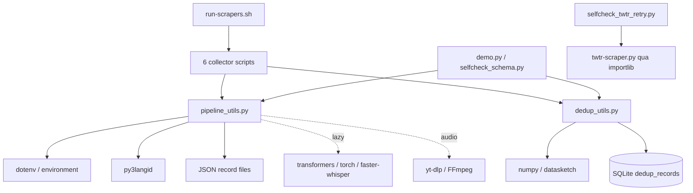

# Audit kiến trúc — baseline 08/10/2026

> **Snapshot lịch sử theo ngày trong tài liệu.** Các trạng thái “chưa triển khai”, disabled hoặc lỗi probe chỉ áp dụng cho lượt kiểm tra đó. Đối chiếu code/config hiện hành ngày 11/10/2026 tại [trạng thái dự án](current-state.md); không dùng snapshot này để kết luận runtime hiện tại.

Ngày audit: **08/10/2026**. Trạng thái: hoàn tất audit/baseline của lượt đầu; **chưa refactor hoặc triển khai SmartCity**.

## 1. Phạm vi và nguồn bằng chứng

- Repository: `D:\task\social_listening\social_media_scraping`.
- Git HEAD: `c876bbf86419c30046585baf808e0411b345ccd7`; working tree sạch trước audit.
- Đã đọc toàn bộ [PRD v0.1](../specs/product/prd.md), ngày 08/10/2026. PRD đang nằm ngoài Git root, tại thư mục cha do người dùng cung cấp.
- SHA256 PRD: `92a23ae94549cd4b94c7d5b2b215121a3e760ed7c03f4c0285fb539e4219efb7`.
- Đã kiểm tra README, sáu collector, hai shared module, demo, hai self-check, runner, CI, requirements, `.env.example`, registry/example inputs và `.gitignore`.
- Không tìm thấy `AGENTS.md` tại repository hoặc các thư mục cha đã kiểm tra. Không đọc credential/session thật hoặc chạy collector live.

Các nhận định về thuật toán dựa trên code và probe offline; nhận định về coverage, độ chính xác model hoặc khả năng truy cập nền tảng chưa được kiểm chứng live. Những phát biểu về platform policy trong comment/README legacy không được coi là kết quả feasibility.

## 2. Kết luận chính

Đây là pipeline thu thập **tài chính/năng lượng**, có hạ tầng hữu ích để mở rộng. Chưa phải hệ thống SmartCity: không có Facebook adapter, Web/Google adapter độc lập, Source Registry có metadata, canonical signal, LLM enrichment, Excel hoặc review storage.

SQLite hiện chỉ lưu **dedup index**, không lưu đầy đủ record. Record nằm trong các JSON array theo account/keyword. NLP hiện là sentiment + financial asset alias/NLI; không thay thế được operational relevance/taxonomy của PRD.

Ưu tiên reuse retry, limiter, Unicode handling, caption/audio extraction, dedup và incremental merge. Tách cấu trúc trước; các thay đổi thu thập tiếng Việt, media fallback, dedup policy và schema thuộc feature phases riêng.

## 3. Cấu trúc và entry points

```text
social_media_scraping/
  *-scraper.py                 6 script collector độc lập
  pipeline_utils.py           1.713 dòng: config, logging, NLP, schema, JSON, ASR
  dedup_utils.py              177 dòng: SQLite + MD5 + MinHash/LSH
  demo.py                    demo synthetic offline
  selfcheck_schema.py        shared schema/config/routing checks
  selfcheck_twtr_retry.py     mocked X retry/fallback checks
  run-scrapers.sh             runner Bash/Linux
  requirements*.txt          core, collection, optional models
  .env.example               runtime config/credential placeholders
  examples/{keywords,sources}/
  assets-registry/asset-registry.example.json
  .github/workflows/ci.yml
```

Không có `pyproject.toml`, `tests/`, `specs/`, `docs/`, `src/`, `engine/` hoặc config YAML ở baseline. Mười một file Python có tổng **6.040 dòng**.

| Entry point | Hàm chạy | Đặc điểm |
| --- | --- | --- |
| `twtr-scraper.py` | `main()` | Keyword/account; account retry passes/cooldown |
| `yt-scraper.py` | `main()` | Keyword/channel; thread pool; preload Whisper |
| `tel-scraper.py` | `main()` → `asyncio.run(run())` | Channel history; session Telethon |
| `reddit-scraper.py` | `main()` | Keyword/subreddit; PRAW read-only |
| `tiktok-scraper.py` | `main()` | Account timeline; optional keyword routing |
| `truth-scraper.py` | `main()` | Authenticated timeline; optional keyword routing |
| `run-scrapers.sh` | subprocess tuần tự | X → YouTube → Telegram → Reddit → TikTok → Truth |
| `demo.py` | `main()` | Không network, không credential/model download |

Tên script chứa dấu `-` nên không import bằng cú pháp module Python thông thường. `selfcheck_twtr_retry.py` dùng `importlib.util.spec_from_file_location` với đường dẫn tương đối tới script X; đây là dependency phải cập nhật khi migration.

## 4. Collectors và behavior cần giữ

| Collector | Acquisition/thời gian | Nội dung, incremental, dedup | Bằng chứng code |
| --- | --- | --- | --- |
| X, 934 dòng | Syndication → `xtf.Router` → DDGS; keyword search/credibility gate | Prefetched + fetched tweets, extended text/media/engagement; merge theo record ID; giữ duplicate flag | `discover_account_tweet_refs`, `_fetch_and_write_tweets`, `_scrape_account_list`, `main` |
| YouTube, 542 dòng | `yt-dlp` search hoặc channel uploads; cutoff ở bước merge | Subtitle API → dịch caption sang English nếu cần → Whisper. Chỉ nhận video có metadata **và text**; bỏ duplicate | `search_youtube_videos`, `extract_video_text`, `_process_single_video`, `_fetch_and_write_videos` |
| Telegram, 528 dòng | Telethon newest-first, cutoff, cap; flood wait retry | Public channel username; bỏ message không text; giữ duplicate; refresh edited message khi bật, mặc định bật | `_collect_messages`, `_with_flood_retry`, `scrape_channel`, `run` |
| Reddit, 447 dòng | PRAW keyword search trong multireddit hoặc `/new`; cutoff | Title + selftext; merge sorted JSON; bỏ duplicate; subreddit đóng vai trò author của schema | `search_submissions`, `_merge_submissions`, `_build_record` |
| TikTok, 474 dòng | `yt-dlp` account listing; cap/cutoff; pinned video cũ dùng `continue` | English VTT → Whisper → description/title; bỏ nếu không còn text; giữ duplicate; keyword mode vào bucket đầu tiên khớp | `list_account_videos`, `fetch_video`, `extract_video_text`, `scrape_account` |
| Truth Social, 624 dòng | Auth/token; Mastodon-style paging; cap, cutoff và account time budget | HTML → text; reblog và media alt text; keyword routing; giữ duplicate | `login`, `_api_request`, `fetch_statuses`, `scrape_account` |

Các giới hạn cụ thể không được âm thầm thay đổi trong Phase 1:

- TikTok keyword mode chỉ lọc account đã cấu hình, **chưa có global keyword/hashtag discovery**.
- YouTube query thêm `news`, dùng `ytsearch30`, channel name resolution chọn search hit đầu tiên. Khi không có trusted match, search dùng các kết quả còn lại; không phải watchlist strict.
- YouTube chưa lưu caption/description riêng và video không transcript bị mất; TikTok có description fallback nhưng không cứu được lỗi fetch metadata và vẫn bỏ video hoàn toàn không text.
- Default language gate là `en,fa`, có confidence threshold; tiếng Việt có thể bị loại trước downstream.
- UTC cutoff tính từ `now()` trong từng collector; chưa truyền khoảng thời gian lịch sử cố định từ run context.
- Default source list X/YouTube/Reddit có thể được tạo khi thiếu file. SmartCity không được vô tình dùng các nguồn tài chính mặc định này.
- Không có cơ chế comment ingestion thống nhất; có count comment, không đồng nghĩa đã crawl comment.

## 5. Shared utilities và dependency graph



`pipeline_utils` không import collector hoặc dedup. `dedup_utils` không import pipeline/collector. Cả sáu collector phụ thuộc hai module này; chưa có dependency cycle first-party. Third-party acquisition: YouTube/TikTok → yt-dlp, X → ddgs/xtf, Telegram → telethon, Reddit → praw/prawcore, Truth → stdlib HTTP.

| Responsibility trong `pipeline_utils.py` | Hàm/trạng thái chính | Hướng xử lý |
| --- | --- | --- |
| Config và paths | `load_dotenv`, `env_*`, `get_scrape_mode`, `*_DIR` | Tách config; giữ precedence/default legacy |
| Logging | `setup_logging` | Tách observability; giữ one-time root handlers |
| Resilience | `with_retry`, `RateLimiter` | Reuse, tách modules chuyên trách |
| Language | `_identifier`, `detect_language`, `language_allowed` | Reuse; cấu hình vi trong phase feature |
| Financial analysis | asset registry/caches/NLI, sentiment bundles, `analyze_text`, `_split_nli_premise` | Giữ một owner cho state/model routing; không đổi thành SmartCity classifier |
| JSON storage | `RecordFile`, `parse_record_timestamp` | Reuse legacy storage; chưa thay direct merge của collector |
| Keyword matching | `keyword_matches` | Reuse token/sub-string semantics legacy |
| Legacy schema quality | platform validators, `build_quality` | Tách legacy schema; tạo validator SmartCity riêng sau này |
| Audio/ASR | `get_whisper_model`, `_download_audio`, `transcribe_audio`, circuit breaker | Tách media; giữ shared model/cache/failure state |

Import hiện có side effects: tải `.env`, dựng language identifier, đặt environment/warning/log levels; import collector tạo rotating log và chụp env vào constants. Đưa tất cả collector vào cùng process sẽ khác runner subprocess, nhất là root logger chỉ cấu hình một lần. Phase 1 cần giữ process isolation.

## 6. Storage và output schema

`dedup_utils._get_conn()` tạo SQLite WAL với timeout 30 giây và bảng:

```text
dedup_records(record_id PRIMARY KEY, content_hash NOT NULL,
              duplicate_group_id NOT NULL, minhash NOT NULL)
```

Chưa có migrations/version table, source registry, crawl run, candidate, enriched record, observations hoặc review history. `load_lsh()` tải toàn bảng vào memory. Các collector ghi JSON riêng; chỉ demo/TikTok/Truth dùng `RecordFile`, những collector còn lại có merge/sort/write riêng.

Top-level JSON keys đã kiểm chứng:

```text
record_id, Source, Content, time_stamps, asset_mention,
sentiment, Engagement, media, deduplication, quality
```

- `record_id = <Platform>_<author_or_channel_id>_<native_item_id>`.
- `Source.Source_id` là **item ID**, không phải ID của configured source/watchlist.
- `Content.raw_text` có thể là post body, transcript hoặc description fallback. Không suy ra evidence provenance chỉ từ tên field.
- `time_stamps` dùng `%Y-%m-%d %H:%M:%S UTC`; `updated_at` nullable, publication có thể thiếu/date-only tùy upstream.
- `deduplication` có hash, flag, group, original ID; không có `duplicate_type`.
- `quality` là completeness/structural scoring 0–100, có extraction errors; **không phải confidence/relevance hoặc xác minh claim**. Validator chỉ nhận sáu platform; self-check chủ động reject Facebook.

`RecordFile.add()` không tự ngăn trùng ID: caller phải gọi `has()`. File write không atomic và không lock. Đọc JSON lỗi có thể reset records rồi ghi đè khi thêm dữ liệu. Việc đăng ký dedup trước khi ghi JSON không nằm trong một transaction chung, có crash window gây mất output. Đây là debt, chưa sửa trong lượt này.

## 7. Deduplication

- Lowercase; bỏ URL; giữ Unicode word characters; bỏ punctuation/emoji; collapse whitespace.
- Exact content key là MD5 của text đã chuẩn hóa; không phải raw byte equality hoặc normalized URL identity.
- Near dùng four-word shingles, MinHash `128` permutations và LSH threshold `0.55`.
- `check_and_register()` loại self-match, cập nhật MinHash khi cùng ID bị sửa và dùng `INSERT OR REPLACE`.
- Near match lấy phần tử đầu của `lsh.query()`, chưa xác minh lại Jaccard và chưa tạo incident semantics.
- SQLite WAL bảo vệ thao tác DB, nhưng in-memory LSH/hash map của mỗi process không tự refresh. Comment nhắc `reload_lsh()` nhưng không có hàm đó. Không coi concurrency dedup là đã được chứng minh.

Probe offline dùng DB tạm cho kết quả: first → nonduplicate; identical → duplicate cùng group; đổi từ cuối `today` thành `again` → near candidate cùng group; unrelated → nonduplicate; gọi lại cùng unrelated ID → không self-duplicate; reload giữ đủ sáu ID.

Probe cũng xác nhận hai chuỗi rỗng khác ID có hash `d41d8cd98f00b204e9800998ecf8427e` và bị gộp. Emoji-only/URL-only có thể gặp cùng vấn đề. Sau structural refactor, SmartCity cần explicit exact/near type, identity theo platform item/canonical URL và policy riêng cho evidence rỗng; near similarity không đồng nghĩa cùng incident.

## 8. Media/audio/transcript

Reuse chain hiện có: captions → `transcribe_audio()` → yt-dlp bestaudio → FFmpeg MP3 → faster-whisper. TemporaryDirectory dọn media; duration caps; model GPU rồi CPU int8 fallback; ba lỗi môi trường CUDA/library có thể tắt ASR cho phần còn lại của process.

Default `WHISPER_TASK=translate`; YouTube ưu tiên English captions/auto-translation, TikTok chỉ yêu cầu `en.*`/`eng.*`. PRD tiếng Việt cần giữ original caption/transcript và provenance; đổi này thuộc phase media/adapter behavior riêng.

Chưa có `MediaResolver`, unified evidence, media status/evidence level, frame sampling, OCR/vision hoặc image resolver. FFmpeg và optional models chưa cài/benchmark trong baseline audit.

Trong `yt-scraper.py:extract_video_text`, comment và `extra_opts` mô tả đổi player client/User-Agent để tránh signature/PO-token checks. Đây là **access-method debt cần kiểm tra trước live SmartCity**, không phải bằng chứng phương pháp được phép. Phase 1 không mở rộng thủ thuật này; source/media path của MVP chỉ dùng phương thức được phép và phải dừng source khi access denied/CAPTCHA. X/Truth là legacy ngoài nguồn ưu tiên MVP, không tự đưa vào live SmartCity scope.

## 9. Scheduling, config, retry và logging

`run-scrapers.sh` đổi CWD về Git root, dùng `.venv/bin/python` nếu có, nếu không dùng `python3`; stdin `/dev/null`; `flock` chống overlap cả runner. Tiếp tục sau process failure, exit nonzero nếu process nào fail. Collector có thể log lỗi rồi return bình thường, nên exit 0 không đủ chứng minh source SUCCESS.

Cron chỉ được mô tả trong comment; chưa có scheduler peak-window hoặc persistent run state. Lookback có thể overlap nếu operator đặt `MAX_PAST_MINUTES` lớn hơn cadence; không có fixed `lookback_start/end` hoặc lock theo source/window. Bash/flock là Linux runtime, chưa có runner PowerShell tương đương.

Config: prefixed env > shared env > code default; shell thắng `.env` cho cùng tên biến. Malformed value warning rồi default; không có semantic/range validation đầy đủ. Inputs là text lists; không có project aliases/source metadata/priority/enabled/access type. Secrets tách `.env` và session, được `.gitignore` loại khỏi Git.

Retry: bounded exponential backoff + jitter ở shared decorator; X cooldown/deferred account passes; YouTube search loop riêng; Telegram async FloodWait theo server; Truth chỉ retry transient 429/5xx/network và giữ trang đã lấy khi paging fail. Một số yt-dlp decorator bắt toàn bộ `Exception`; chưa có shared typed outcome để phân biệt empty, auth, unavailable, rate limit, media/LLM errors.

Log: console + root `RotatingFileHandler`, 5 MB × 3 backups, UTF-8; scraper/step messages và run timestamp text. Không có structured `crawl_run_id/source_id`, metrics table, review/export events hoặc secret-redaction tests.

## 10. Tests và baseline đã chạy

CI hiện tại: Ubuntu, Python **3.12/3.13**, install `requirements.txt`, compile `*.py`, `bash -n`, hai self-check và offline demo. Không có pytest suites/unit/integration/contract fixtures. Self-check schema có khoảng platform, bad URL/ID/content type, config precedence/fallback, RecordFile và fa/en routing; X có tám mocked retry/fallback cases.

Môi trường audit cuối cùng: Windows, **Python 3.13.13**, venv `.venv/audit`, đúng dependencies của repository; không cài requirements-models. [Dependency snapshot](baseline/dependencies.txt), [demo output](baseline/demo.json), [manifest/hash](baseline/manifest.json) là evidence lưu cùng tài liệu.

| Check | Kết quả thực tế | Giới hạn |
| --- | --- | --- |
| `selfcheck_schema.py` | PASS, exit 0 | Sáu platform + shared config/routing/storage; không test SmartCity |
| `selfcheck_twtr_retry.py` | PASS, exit 0; tám cases | HTTP/fetch mocked; không chứng minh X live |
| `demo.py` | PASS, exit 0; 3 records | Synthetic X/Telegram; models disabled |
| Python compile | PASS, cả 11 file | Không chứng minh runtime acquisition |
| Git Bash `-n run-scrapers.sh` | PASS, exit 0 | Chỉ syntax; chưa execute runner/flock/cron |
| Import từng collector trong process riêng | PASS, 6/6 | Không gọi `main`, không network/login |
| Dedup probe DB tạm | PASS các behavior ghi ở §7 | Không phải benchmark/concurrency test |

Demo baseline: IDs `X_demo_news_1800000000000000000`, `Telegram_demo_news_1`, `Telegram_demo_news_2`; language `[en,en,fa]`; duplicate `[false,true,false]`; cả ba complete và quality `100`; Persian record có `USDT`/`XAU`; sentiment null. SHA256 stdout Windows: `e21cd786f9bbf502522f5192a0ee342838ce09834376c04efe3cc09c15661e98`. So sánh parsed JSON khi khác OS/line ending.

Các trở ngại môi trường đã xử lý: Python mặc định 3.14 thiếu packages; uv cache ngoài workspace bị chặn; network sandbox không tải được runtime; Python TemporaryDirectory và Git Bash signal pipe bị sandbox chặn. Đã dùng cache/runtime trong `.venv/`, cài dependencies khai báo và chạy checks offline với sandbox escalation. **Không sửa code để làm test pass**. Lỗi ban đầu là setup/sandbox, không phải kết luận regression của repository.

Có thể chạy lại từ Git root sau khi có môi trường:

```powershell
$env:PYTHONIOENCODING = 'utf-8'
$env:PYTHON_DOTENV_DISABLED = '1'
$env:SENTIMENT_MODEL = 'none'
$env:MULTILINGUAL_SENTIMENT_MODEL = 'none'
$env:ASSET_NLI_MODEL = 'none'
& .\.venv\audit\Scripts\python.exe selfcheck_schema.py
& .\.venv\audit\Scripts\python.exe selfcheck_twtr_retry.py
& .\.venv\audit\Scripts\python.exe demo.py
& 'C:\Program Files\Git\bin\bash.exe' -n run-scrapers.sh
```

Trong sandbox của phiên này, TemporaryDirectory vẫn cần quyền chạy tương ứng; không thay assertions hoặc dùng model/network stubs để che lỗi môi trường.

## 11. Quyết định reuse/refactor/extend và technical debt

| Component | Quyết định | Lý do/impact |
| --- | --- | --- |
| Sáu collector legacy | Reuse + relocation | Giữ workflow/JSON; chỉ YouTube/TikTok ưu tiên adapter MVP |
| Retry/limiter/logging/language | Reuse + tách ownership | Shared behavior đã có baseline; cần test state/side effects |
| Dedup algorithm/SQLite index | Reuse trước, extend sau | Không đổi DB/hash/threshold trong structural phase |
| JSON RecordFile/direct merges | Giữ legacy | Chưa đồng nhất ngay; SmartCity storage additive ở phase sau |
| Whisper/yt-dlp/FFmpeg | Reuse backend phù hợp | Resolver/provenance/vi/frame fallback phải bổ sung |
| Financial sentiment/asset NLI | Giữ riêng legacy | Không phục vụ taxonomy operational, không tự xóa |
| Source registry/canonical schema/LLM/Excel | Extend | Chưa có component tương đương để chỉ rename |
| Bash cron runner | Giữ Linux compatibility | Engine mới bổ sung Windows/source-level schedule sau |

Debt ưu tiên: monolith và code merge lặp lại; import-time env/model/log state; unknown metadata/date handling; JSON non-atomic và dedup crash window; phân loại status mơ hồ; near-group ordering/concurrency chưa ổn định; text-empty collisions; thiếu Vietnamese fixtures; unofficial access chưa live verified; dependency nhiều package chỉ range và CI root-only compile; không có storage migrations/retention/review.

Không replacement nào được thực hiện hoặc cần thực hiện ngay trong lượt audit. Kế hoạch di chuyển và điều kiện hoàn tất ở [refactor plan](refactor-plan.md); mapping toàn bộ FR ở [gap analysis](prd-to-code-gap-analysis.md).
