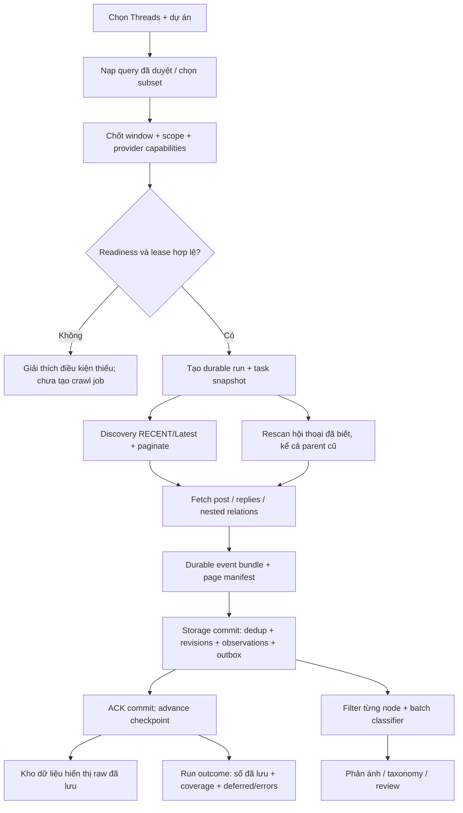
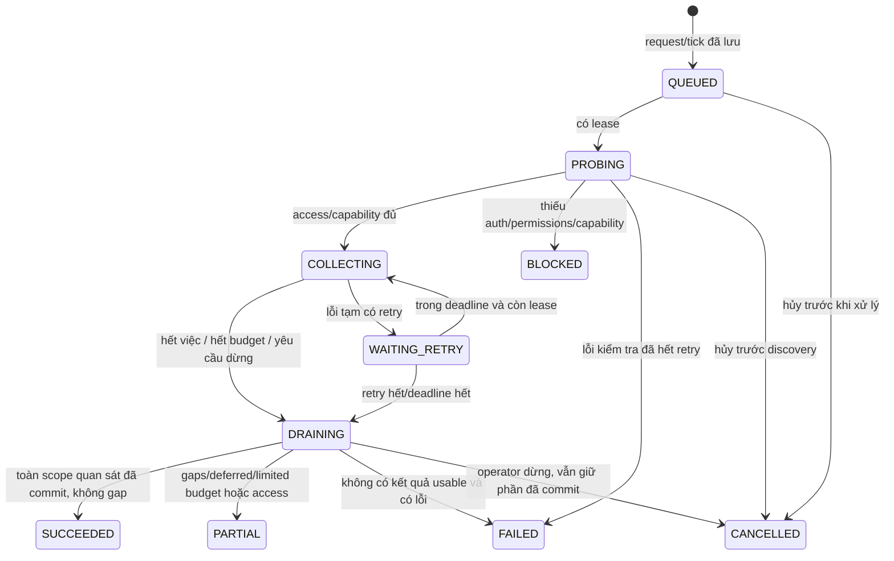

# Thiết kế luồng adapter Threads

Thiết kế **11/10/2026** · Cập nhật **12/10: IMPLEMENTED_SUBSET / LIVE_PARTIAL**. [Plan P0–P7](../implementation-plan-threads.md), [feature](../../specs/features/threads-adapter.md), [contract](../../specs/contracts/multi-platform-conversations.md). Chi tiết dưới đây là kiến trúc mục tiêu; mapping runtime và bằng chứng ở [runbook](../operations/threads-acquisition.md). Browser đã crawl thật; storage daemon chung/FB spool, API và nested mapping còn mở.

## 1. Ranh giới trách nhiệm

| Thành phần | Nhận | Trả / trách nhiệm |
| --- | --- | --- |
| Query Registry | Project scope, aliases, query version, enabled | Immutable snapshot truy vấn được duyệt; query context không phải project evidence |
| Run service / scheduler | Manual request hoặc daily tick, platform, fixed UTC window | Run/task IDs, platform lease, budgets, cancellation, kết quả theo stage |
| Threads adapter | Query/candidate/root + capabilities/cursor/deadline | Candidate/node proposals, next cursor, access errors, observed order/coverage; không ghi DB hoặc gọi model |
| Crawl worker | Run snapshot + inventory + adapter | Discovery + detail + rescan; event bundles vào durable spool, progress và deferred work |
| Storage worker / repository | Verified node proposals + lineage + page commit manifest | Identity/dedup, raw revisions/observations/outbox, commit ACK/checkpoint; giao dịch ngắn |
| Enrichment / classifier | Raw đã commit + OCR nếu có + current context + taxonomy | Filter từng node, batching Gemini, validated analyses, reuse kết quả còn hợp lệ |
| Dashboard projection | Views/raw/analysis/reviews + stages/capabilities | Page/filter/detail/Excel/status; đọc hoặc đổi bộ lọc không gọi crawler/LLM |

Hai producer Facebook/Threads cùng dùng storage queue sau P2, nhưng không dùng chung acquisition mutex. SQLite vẫn tuần tự hóa writers; classifier/OCR/review phải giữ transaction ngắn. Chưa chuyển Facebook sang queue trong bước thiết kế.

## 2. Lifecycle: cấu hình → chạy → xem lại

Discovery và rescan là hai hàng công việc của cùng run; processor có thể xen kẽ theo budget 70/30. Progress không trình bày chúng như hai bộ dữ liệu không trùng: dedup quyết định số unique cuối.

### Readiness và provider

Readiness kiểm tra schema/migration support, storage worker, query/source enabled, capabilities và credentials/profile của **Threads**. Facebook readiness riêng. `probe_access` trả capabilities có ngày kiểm tra, không tự bật lịch hoặc tự xin quyền mới.

P0 chọn API, browser hoặc hybrid. Search capability và public conversation capability là hai gates riêng. Nếu chỉ search đạt, action cho phép thu post phải ghi scope `POST_ONLY`; không tự bỏ replies mà vẫn hiển thị “Bài viết và bình luận”. Scope mặc định mục tiêu `POSTS_AND_REPLIES`, chỉ chạy khi đã chứng minh provider đáp ứng. UI không thay Google search để làm acceptance Threads.

API lookup ID và browser permalink share identity khi object/permalink có evidence. Hybrid ưu tiên method đã cấu hình, không dùng fallback bí mật sau auth denied; observation ghi phương thức thực tế từng page/node.

## 3. Input contract đề xuất

`ThreadsRunRequest` gồm:

| Field | Validation / semantics |
| --- | --- |
| `platform` | Literal `THREADS`; thiếu hoặc khác platform bị từ chối |
| `project_id` | Một project enabled; v1 mỗi manual request chỉ một project. Lịch nhiều project tạo child tasks/run riêng theo scope, không đổi field thành list ngầm |
| `query_ids` | Ít nhất 1 query enabled thuộc scope, dedup IDs; không nhận arbitrary query không lưu version |
| `window_start`, `window_end`, `timezone` | UTC ISO, start < end; UI đổi từ giờ Việt Nam; snapshot không đổi khi người dùng sửa form |
| `scope` | `POST_ONLY` hoặc `POSTS_AND_REPLIES`; capability gate tương ứng |
| `trigger` | `MANUAL|SCHEDULED|CATCH_UP|RECONCILIATION`; cùng acquisition path |
| `idempotency_key` | Request/tick key; double click/retry trả run cũ, không tạo run mới |
| `config_version`, `schedule_id` | Effective snapshot server-side; schedule_id null cho manual |

Provider, secrets, budgets và query contents đọc từ server config, không tin trực tiếp browser payload. Request có query IDs; server lưu original/effective query cùng version để history tái hiện được.

API UX không yêu cầu người dùng hiểu native ID, cursor, schema, token hoặc “most relevant”. Các dữ kiện này thuộc diagnostic detail; provider label API/Browser/Hybrid hiển thị ngắn để giải thích cách lấy dữ liệu.

Mốc mở ca 05:00/17:00 tạo task `INVENTORY_REFRESH` riêng, không gửi run có window rỗng vào contract start < end. Task này chỉ làm mới danh sách hội thoại/query observations và đánh dấu context chưa thuộc window; không ghi nhận bài/phản ánh mới trong ca. Các ticks sau và mốc chốt tạo `WINDOW_COLLECT` với `[slot_start,tick_time)`. Mỗi loại task vẫn dùng lease, durable ingest và history theo nền tảng; UI gọi mốc mở ca là “Chuẩn bị danh sách”, không báo “Đã thu đủ ca”.

## 4. Execution contract và state machine

`EMPTY_VERIFIED` là outcome search hợp lệ không thấy kết quả, không phải synonym của lỗi. Run chỉ SUCCEEDED sau storage ACK; không nói thành công khi còn page chưa commit. Classifier running/failed không đổi acquisition outcome đã lưu: có stage riêng.

Lease key theo `(platform,credential/profile scope)` cho job chạy; scheduler task key theo `(platform,schedule_id,query_id,query_version,start,end)`. Heartbeat độc lập mạng, renew lease có token/version chống worker cũ ACK sau khi hết lease. Same-platform manual request khi đang chạy trả `409 PLATFORM_BUSY` kèm run ID để UI đưa tới lượt hiện tại; Facebook đang chạy không gây lỗi này cho Threads.

### Pagination và thời gian

Adapter page trả: proposals, query observation, cursor continuation, `provider_empty_verified`, `observed_order`, timestamp/extraction gaps, safe error. Không giữ access token trong next URL hoặc cursor payload. Replay cursor có thể expired: quay lại search bounded cùng window, giữ dedup, ghi `CURSOR_RESET`, không coi là coverage đã đủ.

Chỉ dừng sớm theo timestamp nếu ordering và precision đã chứng minh; old/new xen kẽ thì paginate đến budget/exhaustion. Window là tiêu chí xác nhận/report từng node, không hard-drop parent context hoặc node unknown. Run report đếm in-window, out-of-window/context và unknown riêng.

## 5. Commit, dedup và crash recovery

1. Worker parse proposals, lưu bundle atomically vào `sessions/ingest/threads/ready/`; bundle giữ stable page/event IDs và original observed_at. Parse chưa xác minh relationship thì đánh PARTIAL, không chế parent ID.
2. Storage worker claim bằng atomic move/lease; validate envelope schema/checksum/allowlist. Poison bundle vào DLQ với reason; manifest chưa acknowledged.
3. Trong transaction ngắn: resolve aliases theo platform; tạo root/parent refs khi cần; upsert nodes/revisions; append unique observations; tạo outbox khi evidence đổi; lưu ACK manifest và checkpoint tương ứng.
4. COMMIT rồi mới báo ACK cho crawler và archive bundle. Crash trước commit replay nguyên bundle; crash sau commit trước archive đọc durable ACK và không tạo observations/revisions lần nữa.
5. Một page lớn chia nhiều bundles; **page checkpoint chỉ advance khi mọi bundle trong manifest đã ACK**. Thiếu bundle/failed validation giữ page pending, run PARTIAL; không nhảy cursor rồi mất nội dung.
6. API/browser cùng native object → cùng identity, nhiều observations. Facebook native ID trùng numeric ID Threads → hai nodes khác platform. Shortcode không giả làm native media ID.

ACK store đề xuất `ingest_page_commits(page_id,run_id,task_id,manifest_checksum,expected_bundles,committed_bundles,next_cursor_safe,committed_at)`, `ingest_event_receipts(event_id,checksum,run_id,committed_at)`. Schema design mới; transaction must share connection với raw writes. Bản ghi payload/receipts có retention và replay window rõ, không purge trước khi hết retention checkpoint.

Dedup là idempotency nội dung, không làm mất xuất hiện qua query/run. Revision đổi caption/OCR/context phải để downstream biết; timestamps quan sát không tạo revision nội dung mới nếu evidence không đổi.

## 6. Bài cũ có bình luận mới

Inventory root theo platform + source/query occurrence; dữ liệu gồm `last_successful_scan_at`, `last_attempt_at`, `next_scan_at`, partial cursor, latest observed reply time khi có, failure reason. Không ghi successful chỉ vì adapter vừa mở page.

Ví dụ synthetic: parent đăng 04/10, reply phát sinh 11/10 17:20. Tick 17:45 rescan parent đã biết → lưu parent context và reply → filter `published_at` ngày 11/10 hiển thị reply → classifier nhận reply cùng parent evidence. Parent không được tính là post mới ngày 11/10.

Scheduler chia priority cho new roots, partial/resumable roots và oldest successfully scanned roots; old roots không bị loại chỉ vì created_at. Budget chưa đủ ghi deferred count và oldest pending scan age. Không phát hiện được reply của parent chưa từng biết thì ghi blind spot, không báo “0 phản ánh” như kết luận về toàn nền tảng.

## 7. Filter/classifier và output projections

- Raw trước filter. Caption quảng cáo, reply khiếu nại → mỗi node quyết định riêng. Model không được dùng query name làm trích dẫn evidence.
- Resolver thêm `QUERY_CONTEXT` cho query project hint ở input mới/versioned; chỉ explicit caption/OCR hoặc parent evidence đủ mới phân loại project với basis phù hợp. Thay classifier contract cần fixture/regression, không hack GROUP_CONTEXT.
- Batching dùng limits hiện có và target/context/OCR bindings; queue chỉ khi evidence hoặc taxonomy/rules thay. Giữ DONE còn hợp lệ và model gốc; retry failure không classify lại toàn kho.
- Phản ánh hiển thị node analysis, taxonomy, intent, lý do tiếng Việt và review. Kho dữ liệu hiển thị raw độc lập classifier; filter/export/review đọc kho đã commit, không kick LLM.
- Image refs/alt text khác OCR. OCR capability optional: báo chưa xử lý/không hỗ trợ đúng thực tế; không invent văn bản từ ảnh hoặc ảnh replies.

## 8. Run report và điểm nối giao diện

Run projection: run ID, platform, provider/method, project/query snapshot, scope, window UTC/VN, trigger/schedule, lifecycle/status, observed_at/updated_at, per-stage statuses, counters, storage ACK watermark, coverage reasons/errors, deferred tasks, safe next action.

Counters phân biệt `observed_candidates`, `unique_new_posts`, `unique_new_comments`, `unique_new_replies`, `existing_nodes_seen`, `new_revisions`, `in_window_nodes`, `unknown_time_nodes`, `context_nodes`, `pending_ingest`, `unreadable_conversations`. Không cộng candidates vào raw totals; nhiều query có thể cùng node. “Đã lưu” dùng committed counts, không dùng buffer counts. Phản ánh KEEP đếm theo validated analyses, không lấy raw count.

UI deep link tới Kho dữ liệu từ run dùng observations `run_id` + platform; không áp thêm published date để âm thầm ẩn context/unknown. Link tới Phản ánh giữ platform/project/window và date basis explicit. URL trạng thái chia sẻ không chứa secrets.

### Routes dự kiến — chưa có endpoint thực thi

| Route | Dữ liệu / action |
| --- | --- |
| `GET /api/acquisition/platforms` | Provider label, readiness, capabilities, current run, schedule summary theo platform |
| `GET /api/acquisition/query-sets?project_id=...&platform=THREADS` | Query rows/version/enabled/ambiguous flags, chưa crawl |
| `POST /api/acquisition/runs` | Validate snapshot/idempotency/gates; 202 run reference hoặc typed 409/422/503 |
| `GET /api/acquisition/runs/{id}` | Lightweight stage/counters/outcome; node pages lấy riêng |
| `POST /api/acquisition/runs/{id}/cancel` | Không fetch mới, drain safe commits, preserve checkpoint; không xóa data |
| `GET/POST /api/acquisition/schedules/{platform}` | Platform schedule/version; save config riêng khỏi enable |
| `POST /api/acquisition/query-sets` | Versioned query edits, expected_version/conflict, changes áp lượt sau |
| `GET /api/views`, `/api/records/{id}`, `/api/threads/{root}` | Mở rộng catalog/filters/projection platform/query/run; cùng paging/snapshot/review semantics |

API health không trả nguyên mọi raw/caption/replies của 30 lượt chạy. Status payload bounded; đọc stages không build/classify toàn kho. UI abort request cũ, timeout finite, giữ snapshot đang xem và báo dữ liệu cũ khi refresh lỗi.

## 9. Acceptance thiết kế trước implementation

| Case | Acceptance spec | UI phải thể hiện |
| --- | --- | --- |
| Search được nhưng replies bị denied | THR-AC02/03/10 | Scope post-only hoặc PARTIAL có “Chưa đọc được bình luận”; không claim đủ |
| Worker còn lưu 1 page | THR-AC06/07 | “Đang lưu dữ liệu”; raw totals chỉ ACK; không dùng dấu hoàn tất |
| Facebook + Threads chạy cùng lúc | THR-AC07/09 | Trạng thái/lịch/stop riêng; cả hai vẫn được đọc từ kho chung |
| Parent cũ/reply mới | THR-AC03/04/11 | Reply đúng ngày, parent ghi “Ngữ cảnh ngoài khoảng”; đếm node riêng |
| Query/preset form đổi khi run đang chạy | THR-AC01/09 | Run snapshot không đổi; nhãn cấu hình cho lượt sau |
| Model lỗi sau raw commit | THR-AC08/10/11 | Kho vẫn có raw; “Đã lưu / Phân loại lỗi” tách khỏi crawl |
| Không biết timestamp hoặc budget hết | THR-AC02/10/11 | Mục chưa xác minh và deferred riêng; không tính đủ-window |

Thiết kế runtime → giao diện ở [Threads workspace UX](threads-workspace-ux.md). Runtime đã có routes `/api/acquisition/{catalog,runs,queries,schedule,cancel}`; trạng thái từng phần ở [TODO](../../TODO.MD), live outputs ở runbook. Contracts đầy đủ chưa được nghiệm thu chỉ từ pilot hữu hạn.
