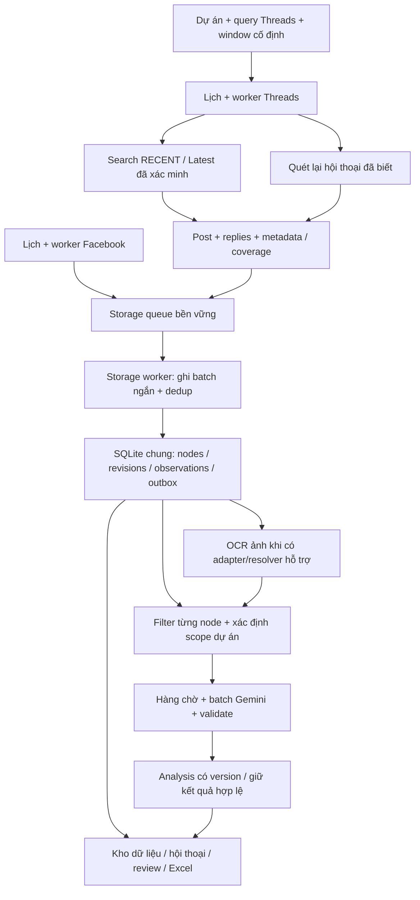

# Kế hoạch triển khai adapter Threads

Ngày thiết kế: **11/10/2026** · Runtime cập nhật **12/10/2026: IMPLEMENTED_SUBSET / LIVE_PARTIAL**. Trạng thái thực thi từng task ở [TODO](../TODO.MD); provider, output, lịch và giới hạn ở [runbook](operations/threads-acquisition.md). Các phase/gate dưới đây là đích nghiệm thu đầy đủ, chưa hoàn thành toàn bộ.

Kế hoạch này bổ sung mạng xã hội Threads vào hệ thống hiện tại. Chỉ tài liệu được tạo trong bước này; chưa có adapter, migration, credential, lịch Threads hoặc crawl live được triển khai. Các chỉ số và cấu hình dưới đây là mục tiêu/pilot đề xuất, không phải kết quả đã đo.

Đặc tả: [Threads adapter](../specs/features/threads-adapter.md), [lưu trữ nhiều nền tảng](../specs/contracts/multi-platform-conversations.md). Baseline: [trạng thái dự án](current-state.md), [conversation v2](../specs/contracts/conversation-record.md), [lịch Facebook](operations/dashboard-crawl-schedule.md).

Thiết kế chi tiết: [luồng adapter/storage/classifier](design/threads-adapter-flow.md) và [UX/UI theo Impeccable](design/threads-workspace-ux.md). Đã triển khai chọn **Facebook / Threads** trong tab **Thu thập**; nguồn/query, lượt chạy và lịch độc lập, Kho dữ liệu/Phản ánh dùng chung có bộ lọc nền tảng. Browser đã pilot thật; API, nested mapping, OCR Threads và monitoring ba ngày còn mở.

## 1. Đầu vào, mục tiêu và output nghiệm thu

| Đầu vào cần có | Mục tiêu | Output nghiệm thu |
| --- | --- | --- |
| Hai dự án hiện có: VinCons, VinWonders Vũ Yên; taxonomy runtime | Theo dõi theo dự án, tránh topic quá rộng | Bộ truy vấn versioned; kết quả xác định dự án bằng evidence, không bằng query đơn thuần |
| Kho raw, revisions, observations, jobs, reviews hiện tại | Facebook và Threads lưu chung, không lẫn identity | Migration rehearsal, backup/rollback, hai nền tảng ghi đồng thời qua storage worker |
| Quyền API hoặc phiên browser Threads, tập bài đối chứng | Thu bài mới và replies thuộc window | Báo cáo pilot có query, provider, window, số node, lỗi và giới hạn coverage |
| Lịch 05:00–08:30 và 17:00–18:30, chu kỳ 45 phút | Hai luồng crawl độc lập với lịch tương tự | Lịch Threads có ID/task/lease riêng; không chặn lượt Facebook |
| Gemini đã cấu hình, classifier hiện hành | Lưu trước rồi filter/classify theo taxonomy dự án | Batch hợp lệ, lý do tiếng Việt, lưu kết quả và giữ kết quả còn hợp lệ |
| Dashboard Phản ánh/Kho dữ liệu/Thu thập/Excel | Xem, lọc và đánh giá xuyên nền tảng | Cột Nền tảng, nguồn truy vấn/tác giả, post/reply, ngày đăng/thu, taxonomy và review |

## 2. Chốt mục tiêu crawl theo dự án

- Truy vấn chính dùng tên và biến thể dự án: `VinCons`, `VinWonders Vũ Yên`, `VinWonder Vũ Yên`, `Vin Wonders Vũ Yên`. Chạy từng chuỗi độc lập; không giả định nhà cung cấp hỗ trợ toán tử OR/AND hay exact phrase.
- Tên mơ hồ như `Vũ Yên` là query khám phá **tắt mặc định**; muốn bật phải có điều kiện xác minh ngữ cảnh công viên/địa điểm. `VinGroup`, `kẹt xe`, `khiếu nại` không nằm trong bộ theo dõi chính vì scope quá rộng.
- Hashtag/topic tag là query bổ sung khi capability đã kiểm chứng. Không giả định hashtag Threads tương đương hashtag TikTok, hoặc thấy `#` trong truy vấn là bài thực sự có tag đó.
- Không yêu cầu bài có từ chỉ vấn đề. “Đợi cả tiếng mới vào được” vẫn có thể là phản ánh. Taxonomy áp dụng sau lưu raw.
- Source của search là **query scope**, không phải group. Tác giả là author reference; một kết quả search không tự tạo/bật watchlist profile.
- Lưu query original/effective, query ID/version và mọi observations. Một bài tìm qua nhiều query chỉ có một identity nội dung.
- `VinCons` là scope tổ chức; chưa được suy ra công trường cụ thể. Muốn theo dõi từng công trường phải bổ sung tên, alias và địa điểm đã xác nhận.
- Bài/reply ngoài dự án, quảng cáo/bán hàng/tuyển dụng vẫn được lưu raw theo luồng mới. Filter quyết định hiển thị/phân loại từng node; không purge raw.

Đối tượng theo dõi có giới hạn: nội dung nhà cung cấp trả về qua query đã duyệt + hội thoại đã biết. Không cam kết tìm mọi bài trên toàn Threads hoặc mọi replies của bài chưa từng phát hiện.

## 3. Chọn cách thu thập: pilot trước khi khóa provider

**Ưu tiên kiểm chứng API chính thức cho keyword search**, vì collection của Meta mô tả `keyword_search` với `TOP`/`RECENT`. Dùng `RECENT` cho yêu cầu bài gần nhất, nhưng vẫn kiểm tra timestamp từng node và phân trang. [Meta — Search for Threads Posts](https://www.postman.com/meta/threads/request/m9j4i2x/search-for-threads-posts).

Collection Meta có các endpoint replies/conversation và trường root/parent. Tài liệu này **không coi sự tồn tại endpoint là bằng chứng token sẽ đọc được toàn bộ replies của bài công khai từ tài khoản khác**. P0 phải test riêng bài của tài khoản đã cấp quyền và bài public của người khác. [Meta — Get Threads Replies](https://www.postman.com/meta/threads/request/34203612-11c959db-21cb-4303-b717-73b661b3579c), [Meta — Get Threads Conversations](https://www.postman.com/meta/threads/request/34203612-13ebe336-0176-4d2b-b208-c36646093139).

| Kết quả P0 | Phương án triển khai |
| --- | --- |
| API search + đọc conversation public đạt | `THREADS_API` cho cả discovery/fetch/replies |
| API search đạt, replies public không đạt; browser đạt | `THREADS_HYBRID`: API discovery, browser permalink/replies; chung identity và observations ghi rõ method từng lần |
| Chưa có quyền API; browser search Latest và replies đạt | `THREADS_BROWSER` dùng Playwright Python + Chromium, profile riêng |
| Không phương án nào đọc được replies public | Chỉ nghiệm thu khả năng lấy post; feature tổng thể giữ `LIVE_PARTIAL`, không đánh dấu ACP post+comments |

Browser chỉ chạy giao diện public/phiên đăng nhập được cấp; login thủ công khi cần. CAPTCHA/login/access denied dừng tác vụ và báo outcome. Không tự fallback sau mỗi lỗi API: provider/capabilities được chọn trong config, có provenance và giới hạn rõ.

Phải ghi capability matrix: search recent, pagination, window filtering server-side, lookup by ID/permalink, public replies, nested parent mapping, profile discovery, media. Mỗi ô có `SUPPORTED`, `UNSUPPORTED`, `UNVERIFIED` + ngày/bằng chứng. Không đưa `since/until`, page size, số request/ngày hoặc quyền arbitrary profile vào implementation chỉ từ suy đoán.

Trang developer Meta trả HTTP 429 trong lượt đọc tài liệu 11/10/2026. Dùng collection chính thức của Meta làm căn cứ endpoint sơ bộ; P0 phải đọc lại changelog/permissions/limits và token thực tế. Không chốt quota/chi phí provider trong bản kế hoạch. [Meta collection](https://www.postman.com/meta/threads/documentation/dht3nzz/threads-api), [changelog](https://developers.facebook.com/docs/threads/changelog).

## 4. Workflow và kiến trúc

- `src`: provider HTTP/browser, parser, URL identity, models, repository. `engine`: registry/query dispatch, schedule, tasks/checkpoints, storage/classification orchestration. Giữ dependency `engine → src`.
- Crawler chịu trách nhiệm access, discovery, pagination, timestamp, relationships và coverage. Chỉ dedup tạm trong job để bớt fetch; dedup bền vững thuộc storage worker/repository.
- Database vẫn là SQLite WAL. Một storage worker ghi acquisition cho cả hai nền tảng; classifier/OCR/review còn là writers riêng, nên vẫn cần giao dịch ngắn, timeout/retry có giới hạn. Queue không tự loại bỏ mọi khóa SQLite.
- Không giữ transaction ghi trong lúc gọi mạng, OCR/LLM, chuẩn bị batch hoặc rà lịch sử toàn kho. [Bài học khóa database ca 2](operations/ca2-dashboard-recovery-20261011.md).
- Storage queue phải nằm trên đĩa (spool đề xuất dưới `sessions/ingest/` với atomic rename), có event ID, retry/DLQ và payload version. Crawler checkpoint chỉ advance sau ack đã commit; replay sau crash không tạo duplicate. Memory queue chỉ là buffer.
- Full content chỉ enqueue classifier sau raw commit. Kết quả acquisition không phụ thuộc API Gemini đang có lỗi hay không.

### Những chỗ phải mở rộng trong code hiện tại

| Baseline | Thay đổi cần làm |
| --- | --- |
| `ContentNode`/URL validation chỉ nhận Facebook | Thêm decoder versioned đa nền tảng; không ghi Threads vào payload Facebook |
| `ConversationStore.aliases()` gắn `FACEBOOK:` | Namespace Threads riêng; giữ nguyên alias/node ID Facebook |
| `Registry.SUPPORTED` và Candidate chưa có Threads | Thêm `THREADS_SEARCH`; profile source hoãn nếu chưa pilot; validator query/project/provider |
| Identity chỉ allowlist Facebook/TikTok/YouTube | Thêm permalink/profile Threads đúng loại, alias domain/shortcode có evidence |
| Conversation worker/group tracing gọi Facebook trực tiếp | Dispatch theo platform/capability, giữ worker Facebook hoạt động cũ |
| Browser profiles chỉ Facebook/TikTok | Thêm Threads nếu chọn browser/hybrid; khóa profile riêng |
| Dashboard scheduler có một global acquisition lock | Chuyển gate chạy sang platform/schedule; Facebook và Threads không chặn nhau |
| Library có điều kiện platform Facebook, UI nguồn là group | Filter/backend catalog/export đa nền tảng; label Nguồn phù hợp search/author |
| Taxonomy profile đang gắn Facebook source IDs | Scope resolver dùng query-project hint tách khỏi explicit project evidence |

Không sao chép module theo đúng tên đề xuất nếu có abstraction dùng lại được. Chỉ bổ sung runtime sau khi P0 khóa capability/provider.

## 5. Window, bài cũ có replies mới và lịch

- Window chuẩn `[start_utc,end_utc)`, UI giờ Việt Nam. Chọn ngày 11/10/2026 là `2026-10-10T17:00:00Z` đến trước `2026-10-11T17:00:00Z`. Timestamp chưa rõ giữ null/precision, không dùng collected_at làm published_at.
- Tính window theo từng node. Parent cũ ngoài window vẫn được lưu/lấy làm context; reply mới trong window phải xuất hiện ở kết quả ngày của reply.
- Duy trì inventory hội thoại đã biết: root ID, query/source occurrences, last seen, scan cursor/checkpoint, last successful scan, next scan, coverage và missing relations.
- Mỗi tick gồm discovery bài mới và rescan các parent đã biết. Đề xuất chia budget 70% discovery/new conversations, 30% old-conversation sweep; scheduler ghi deferred backlog khi không đủ.
- Ưu tiên parent có hoạt động mới; thêm round-robin parent lâu chưa quét để tránh starvation. Không loại parent chỉ vì ngày đăng cũ. Thời gian tăng dần của replies chỉ được dùng dừng sớm khi provider/order đã kiểm chứng.
- Khi không có activity feed đáng tin cậy, chỉ biết replies mới sau khi rescan parent đã biết. Bài cha chưa phát hiện/private/ngoài khả năng search là blind spot phải ghi trong report.
- Catch-up thủ công hoặc sau downtime dùng từng window nhỏ đã chốt. Reconciliation đề xuất 24 giờ cho dữ liệu xuất hiện trễ, có task và budget riêng; giữ ngày phát sinh và thời gian phát hiện riêng.

Lịch Threads riêng, mặc định seed **disabled** đến khi qua live gate: ca 1 **05:00–08:30**, ca 2 **17:00–18:30**, chu kỳ **45 phút**. Các mốc ca 1: 05:00, 05:45, 06:30, 07:15, 08:00, chốt 08:30; ca 2: 17:00, 17:45, chốt 18:30. Mốc mở ca inventory-only, không tạo window rỗng để phân loại; tick sau dùng window tích lũy từ đầu ca tới mốc, dedup qua storage. Cấu hình có thể đổi, không sửa lịch Facebook đang lưu.

Tick và lease bền vững có `(platform,schedule_id,query_version,window_start,window_end)`. Không chạy chồng cùng profile/token scope khi có hạn chế; nhiều nền tảng có thể chạy cùng lúc. Run dài phải coalesce/catch-up theo window có ghi nhận, không bỏ tick âm thầm. Thông báo rõ bài **ngoài hai ca không thuộc lịch mặc định**; backfill trọn ngày là tác vụ khác.

## 6. Defaults pilot và tài nguyên

| Cấu hình đề xuất | Default |
| --- | --- |
| Query | Tối đa 6 query chính/run cho hai dự án; query mơ hồ tắt |
| Candidate/search | Tối đa 100/query, 5 trang/query; giới hạn page size theo provider đã xác minh |
| Rescan | 20 hội thoại đã biết/run; 100 replies/conversation, paginate trong budget |
| Runtime | 120 giây/query, 120 giây/conversation, 20 phút/run; timeout request 20 giây |
| Retry | Tối đa 2 retry lỗi tạm, trong deadline; tôn trọng Retry-After/backoff |
| API request cap | 100 request/run ở phía ứng dụng, mọi retry/lookup/replies đều được đếm; không phải quota Meta |
| Worker | 1 Threads crawl job/scope; Facebook độc lập; 1 acquisition storage worker |
| Storage queue | Backpressure khi đạt 10.000 event hoặc 500 MB; không drop event; pause và báo QUEUE_BACKPRESSURE |
| Media | Lưu refs/alt text; OCR ảnh POST chỉ bật sau resolver pilot; không mặc định download video/ASR |
| LLM | Tái sử dụng batch limits/config hiện có; không gọi model cho từng trang search |

Tài nguyên trước P0: Meta app có Threads use case, tài khoản đã authorize và token có permissions được kiểm tra; `threads_basic`, `threads_keyword_search`, `threads_read_replies` là danh sách **cần đối chiếu**, không xin toàn bộ scope publish/manage trong collection. App Review/advanced access nếu Meta yêu cầu được coi là dependency ngoài đội, không cam kết có ngay. Nếu browser: Chromium + profile Threads/login thủ công. Không yêu cầu gửi token/key qua chat.

Runtime browser dùng profile `sessions/browser/threads/`, không cần API token. Prototype API đọc `THREADS_ACCESS_TOKEN`, chưa pilot. Tập nghiệm thu đầy đủ vẫn cần 10 post public, ít nhất 2 parent cũ có reply mới, 1 nested conversation; query names/aliases và nhóm ngoài scope; địa điểm VinCons chỉ bổ sung khi người dùng xác nhận.

## 7. Phases, công việc và điều kiện nghiệm thu

Effort là ngày kỹ thuật ước lượng cho một người, không gồm chờ credentials/App Review. Thực hiện theo gates, không hứa thời gian trước pilot. Không triển khai đồng thời toàn bộ browser/API nếu chưa cần.

| Phase | Đầu việc / ID | Output | Gate / effort dự kiến |
| --- | --- | --- | --- |
| **P0 — phạm vi và feasibility** | THR-T01 query/project; T02 API/browser capabilities; T03 pilot đối chứng | Query draft, capability matrix, provider decision và report gap | Chọn provider có bằng chứng search + public conversation; nếu replies chưa đọc được phải giữ partial. 1–2 ngày, access có thể kéo dài |
| **P1 — contract và migration** | T04 models/URL/identity; T05 migration/rollback; T06 source/query registry | Versioned schema/fixture; backup và rehearsal | Facebook IDs/reviews/revisions/analyses không thay; cross-platform native ID không collision. 2–3 ngày |
| **P2 — lưu trữ đồng thời** | T07 durable spool/ack/DLQ; T08 storage worker/retry; T09 contract/concurrency tests | Hai producers + chung storage path; retry/crash reports | Không mất/nhân bản node khi replay; checkpoint chỉ sau commit; writers không giữ lock qua network. 2–3 ngày |
| **P3 — discovery và conversation** | T10 search/pagination; T11 detail/replies/parents; T12 old-thread rescan/checkpoint | Adapter provider đã chọn; CLI pilot và outcome/coverage | Truy vấn thật + parent cũ/reply mới + nested identity đạt; API/browser errors không thành empty SUCCESS. 3–5 ngày |
| **P4 — filter/classifier/OCR** | T13 project hint/evidence; T14 intents/batch/reuse; T15 OCR resolver optional | Raw-to-analysis flow chung, OCR capability riêng | Complaint dưới quảng cáo không mất; completed hợp lệ reuse; không cần OCR mới mới nghiệm thu text/replies. 1–2 ngày |
| **P5 — schedule và vận hành** | T16 platform schedule/lease; T17 catch-up/health/rate limit | CLI scheduler riêng, closing ticks, per-platform progress | 2 ca/45 phút, restart/catch-up, run overlap, lỗi Threads không dừng Facebook. 2–3 ngày |
| **P6 — dashboard và export** | T18 filters/source/context; T19 platform schedule UI/Excel | Các tab dùng backend contract, ngày đăng/thu rõ ràng | Filter platform/project/query/type/relevance hoạt động; raw còn lại, reviews/Excel cùng view; timeout không treo. 2–3 ngày |
| **P7 — nghiệm thu và rollout** | T20 regression/held-out/live multi-day | Bộ evidence + báo cáo thiếu/phần đã đạt + runbook | Đạt các AC bên dưới, operator review; 3 ngày chạy thật tối thiểu, rollback diễn tập. 2–3 ngày kỹ thuật + thời gian quan sát |

P0 đã pilot tách biệt trước khi ghi vào kho chung. P1/P2 đạt phần schema/ACK cần cho Threads; Facebook vẫn chưa chuyển sang spool chung. Facebook baseline regressions tiếp tục là gate. Trạng thái T01–T20 đọc ở [TODO](../TODO.MD); không lấy fixtures offline làm chứng cứ live hoặc full ACP.

## 8. Acceptance và kiểm thử hệ thống thật

| AC / requirements | Input và thao tác | Expected output / bằng chứng |
| --- | --- | --- |
| THR-AC01 / 001,002 | Query VinWonders Vũ Yên và Vũ Yên ambiguous; Unicode/alias; query disabled | Query lineage đúng; disabled không gọi provider; query context không trở thành explicit project match |
| THR-AC02 / 003,004 | Search RECENT/Latest thật, bài cũ xen mới, hết trang/không có kết quả | Post ID/text/time có provenance; phân biệt EMPTY_VERIFIED, PARTIAL và errors; order không chứng minh all coverage |
| THR-AC03 / 005,006 | Parent ngoài window, direct/nested replies trong window | Node riêng; root/parent đúng; reply có trong kết quả ngày, parent context không cộng vào số trong window |
| THR-AC04 / 006,007 | Parent đã lưu từ trước, reply mới sau lần scan; nested reply thiếu parent | Rescan tìm reply và giữ observation; thiếu parent tạo reference/unresolved, không ghép sai hoặc invent text |
| THR-AC05 / 008 | Facebook và Threads cùng native ID; 1 Threads post qua 3 query, API/browser | Hai platform không collision; Threads 1 node nhiều observations; URL shortcode không giả làm API ID |
| THR-AC06 / 009,010 | Replay 3 lần, sửa caption, crash sau enqueue/trước ack và sau commit/trước ack | Không duplicate node; revision mới khi nội dung đổi; lịch sử/review giữ; checkpoint/outbox không mất event |
| THR-AC07 / 010 | Hai producers mỗi nền tảng 1.000 fixture events + classifier/review writer | Count đúng sau replay; không mất ACK hoặc dữ liệu; retry bounded; UI page đầu mục tiêu p95 ≤5 giây trên máy pilot và kho 10.000 nodes |
| THR-AC08 / 011,012 | Quảng cáo/tuyển dụng/bán hàng; complaint dưới bài quảng cáo; reply hỏi thông tin | Lưu raw tất cả; filter từng node; complaint không bị parent DROP kéo theo; labels/reasons tiếng Việt, batches và reuse đúng |
| THR-AC09 / 013 | Hai ca, 45 phút, closing ticks; restart/máy ngủ/run dài; Facebook + Threads đồng thời | Tick keys idempotent, catch-up/coalesce báo rõ; enabled riêng; Facebook không bị lock global Threads chặn |
| THR-AC10 / 014,015 | Token expiry/permission denied/429/CAPTCHA/parser mismatch/cursor hết hạn/budget hết | Outcomes riêng, giữ partial/checkpoint, không log secrets; nguồn lỗi không dừng nền tảng khác |
| THR-AC11 / 016 | Lọc platform/dự án/query/ngày đăng hoặc thu/post/reply; mở context/review/export | Backend/UI/export cùng scope; nền tảng và nguồn hiển thị đúng; unknown time không bị giả in-window |
| THR-AC12 / 017 | Media/quote/repost và OCR ảnh chữ nếu bật | Media refs đúng; quotes là post riêng có relation, không thành reply; OCR có origin/quality, không dùng alt text giả OCR |
| THR-AC13 / 018 | Pilot đối chứng 10 post + 2 parent cũ, 3 ngày lịch thật, rerun window | Capture known IDs/time/visible replies khi lập tập đối chứng; số found/missing/unreadable và lý do; không lấy mocks hoặc Google làm Threads live proof |

Trong tập đối chứng **đã xác minh accessible và trong budget**, mục tiêu 100% known IDs được lưu hoặc mỗi ID có failure cụ thể và kế hoạch xử lý; **full data ACP chỉ đạt khi không còn missing IDs của tập này**. Nếu quota/ẩn replies/budget chặn thì ghi LIVE_PARTIAL, không đổi mẫu để đạt 100%. Search coverage toàn Threads không có ground truth, chỉ báo tập quan sát và blind spots. Bộ taxonomy held-out đề xuất 50 node gồm phản ánh/ngoài scope/quảng cáo/replies; recall ≥90%, precision ≥85% trên mẫu đã reviewer gán nhãn, không gọi đó là accuracy toàn nền tảng.

Mỗi report live phải có run/query IDs, provider/version, quyền đã xác minh (không token), window UTC+VN, config snapshot, pages/requests/time/stop reasons, known IDs đối chứng, stored post/reply counts, unresolved/missing, latency và classification provenance. Kết quả chỉ được ghi khi thực sự chạy.

## 9. Rollout và rollback

Backup SQLite nhất quán trước migration; thử restore trên DB riêng; kiểm tra FK/integrity và counts/hashes các node/reviews/analyses Facebook. Feature flag Threads disabled ban đầu; pilot manual 1 query/1 dự án, rồi 2 dự án, rồi schedule 3 ngày. Chưa có actor/reviewer thì ACP người dùng giữ pending.

Rollback ưu tiên tắt Threads producer/schedule, drain queue và giữ raw/analysis đã thu. Không xóa Threads để ép chạy binary v2 không đọc được schema mới. Downgrade đầy đủ chỉ qua restore backup đã nghiệm thu + replay các events sau backup; phải có kế hoạch giữ dữ liệu mới/reviews trong thời gian nâng cấp. Không migrate production trong bước viết tài liệu.
