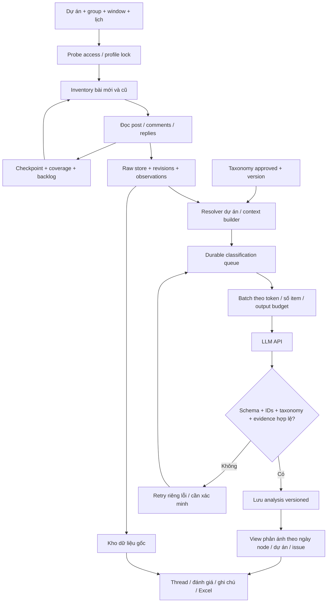
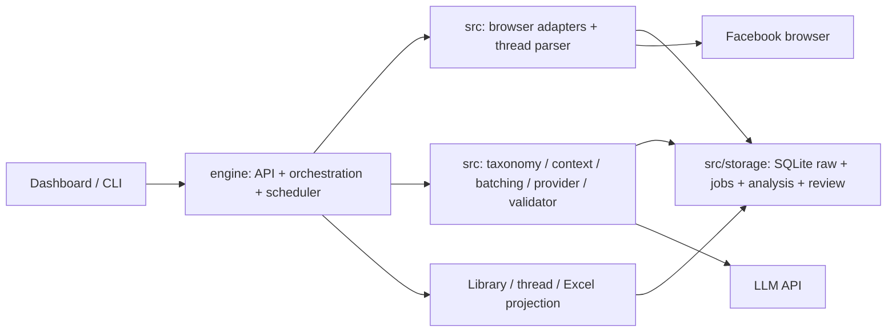

# Kế hoạch hệ thống thu thập và phân loại phản ánh theo dự án

[WBS triển khai và nghiệm thu](execution-and-live-acceptance-v2.md) giữ 24 tasks và 14 LIVE cases. Code raw/tasks/classifier/OCR/workspace đã có increment; [trạng thái hiện hành](current-state.md) đối chiếu implementation với acceptance còn thiếu. Money budget deferred; không coi mọi LIVE case đã pass.

**Thiết kế/acceptance gốc:** [phase P0–P6](phased-delivery-v2.md), raw → filter → batch/classify, closing runs và evidence gates. CLI date catch-up khác dashboard ngoài khung không replay toàn bộ missed ticks. Runtime/lịch hiện tại theo [runbook](operations/dashboard-crawl-schedule.md).

Thiết kế ngày 09/10/2026, đồng bộ 11/10/2026: **core đã triển khai, full live/product acceptance pending**. Các phần kế hoạch bên dưới không phải trạng thái runtime hiện tại; [group tracing](../specs/features/facebook-group-tracing.md), [conversation schema](../specs/contracts/conversation-record.md) và [requirements matrix](../specs/traceability/requirements-matrix.md) ghi scope liên quan.

## 1. Kết quả cần đạt

Người dùng chọn dự án/group/ngày, xem được bài, comment và reply thu thập trong nguồn truy cập được; kho không reset khi crawl lại. Hệ thống tìm phản ánh kiểm soát ra vào, kẹt cổng và những vấn đề đã cấu hình theo từng dự án. LLM phân loại dữ liệu đã lưu, theo batch, có schema và evidence; người dùng xem context, sửa đánh giá, ghi chú và export.

Không bỏ comment mới vì bài cha đã cũ hoặc là quảng cáo. Tách ngày phát sinh phản ánh khỏi ngày crawl, raw khỏi analysis, content count khỏi issue count/vụ việc count. Chưa triển khai entity resolution vụ việc thì không gọi 10 comments là 10 vụ việc độc lập.

## 2. Baseline và khoảng trống

| Thành phần | Đã có trong code/config | Phải bổ sung cho v2 |
| --- | --- | --- |
| Registry/browser | Group watchlist, project VinWonders Vũ Yên, Playwright/profile/session | VinCons project entry nếu dùng taxonomy riêng; comment access pilot |
| Acquisition | Facebook post discovery/fetch; Google discovery; TikTok adapter modes | Comment/reply parser, bài cũ inventory/sweep, coverage/checkpoints |
| Storage | SQLite records/observations/reviews/queue, identity aliases | Raw node/thread/revisions; v2 migration; bỏ purge theo nhãn trong mode v2 |
| Filter | Deterministic prefilter và project matcher | Taxonomy per-project, classifier grounded theo node/context, reprocess |
| LLM | Legacy text analysis; contract operational v1 còn planned | Provider adapter, durable jobs, batch builder, v2 validator, usage/budget |
| UI/lịch/export | Table library/review/notes/export, chọn dự án, lịch crawl | Raw/phản ánh views, comments/thread, pipeline backlog/coverage, taxonomy version |
| OCR | Plan tài liệu | Thực hiện sau pipeline text, không thay parser comments |

Đây là đối chiếu sự hiện diện code/spec, không xác nhận live acceptance toàn tính năng. Không đọc/kiểm chứng API key trong lượt lập kế hoạch; người dùng cho biết đã chuẩn bị API nhưng provider/model chưa chốt.

## 3. Flow tổng thể

### Chuỗi xử lý một phản ánh

1. Lịch hoặc người dùng tạo run có window và source scope cố định.
2. Browser đọc bài và mở comments/replies; lưu từng batch trước khi tiến checkpoint. Bài cũ có trong inventory vẫn được quét lại.
3. Raw store nhận node/revision và source occurrence. Không gọi LLM đồng bộ trong browser loop để API chậm không giữ profile lâu.
4. Outbox/job reconciliation đảm bảo raw vừa commit có classification job; crash giữa raw commit và enqueue được repair bằng scanner. Job có revision/context fingerprint.
5. Context builder lấy target và cha cần thiết, resolver lấy candidate dự án, nạp taxonomy đã approved. Không lọc cứng keyword trước LLM; thiếu text vào trạng thái chờ extraction/review.
6. Batch builder gom items cùng profile, tuân thủ token/output/request/budget. Worker gọi API và validator kiểm tra result theo IDs, không theo vị trí array.
7. Commit valid results từng item, retry lỗi có giới hạn. Raw tồn tại dù LLM unavailable; thiếu result vẫn hiển thị pending/failed rõ.
8. View phản ánh dùng analysis hợp revision hiện tại, lọc ngày của node, không ngày bài cha. Review/notes override được lưu cùng audit; raw không sửa theo lời model.
9. Khi đổi taxonomy/prompt, tạo analysis mới từ kho; không crawl lại. Khi raw/context thay đổi, cache phải invalidated và enqueue lại.

## 4. Kiến trúc triển khai

Giai đoạn đầu giữ ứng dụng Python hiện có, SQLite trên một máy và browser profile riêng; không đưa Redis/Kafka/microservices vào chỉ để chia batch. Acquisition worker và LLM worker độc lập về hàng chờ/budget, cùng repository. Queue/jobs trong SQLite có lease/transaction; serialize writers/short transactions và retry lock phù hợp. Nhiều máy hoặc contention thực tế mới đánh giá PostgreSQL/task broker qua ADR.

Dependency **engine → src**. `src` chứa contracts/parsers/storage/provider logic; `engine` chọn nguồn, dispatch và điều phối; UI không gọi LLM trực tiếp hoặc giữ API key. Không tiếp tục mở rộng mọi logic trong `engine/dashboard.py`; chuyển services trước khi nối flow v2.

| Module dự kiến | Trách nhiệm | Vị trí đề xuất |
| --- | --- | --- |
| Conversation models | Node/relationship/time/extraction enums, validation | src/domain/conversation.py |
| Thread parser | Post/comments/replies, locator, native IDs, timestamp precision | src/acquisition/facebook_threads.py |
| Raw repository | Nodes/revisions/observations/coverage/tasks + migration | src/storage/conversations.py; src/storage/migrations/ |
| Taxonomy registry | YAML/version/mapping/approved validation | src/analysis/taxonomy.py |
| Project/context resolver | Candidates, explicit/context, payload provenance | src/analysis/context.py; tái sử dụng src/acquisition/projects.py |
| Batch/provider/validator | Limits, JSON, grounding references, provider abstraction | src/analysis/batching.py; providers/; validation.py |
| Job repository | Lease/dedup/retry/outbox/attempt usage | src/storage/classification.py |
| Crawl service | Inventory/backfill/sweep/checkpoints, access isolation | engine/group_tracing.py |
| Classification service | Queue dispatch/reprocess/rate-limit/budget | engine/classification.py |
| UI services | API jobs/library/thread/review/export, legacy projection | engine services, dashboard.html/js và library_export.py |

Đây là module map đề xuất, chưa tạo code. Khi triển khai kiểm tra existing abstractions và reuse, không tạo bản sao module chỉ để đúng tên bảng.

## 5. Dữ liệu và schema output

Storage phân lớp: raw nodes + revisions; observations/source occurrences; run/task/checkpoints/coverage; taxonomy snapshots; classification jobs/batches/attempts; node analyses; review history. Không dùng caption field chứa concatenated toàn bộ comments.

Output người dùng là projection ghép **metadata gốc** và **analysis đã validate**:

| Nhóm | Fields |
| --- | --- |
| Nguồn/identity | node_id, node_type, source_id/group, root_post_id, parent_node_id, URL/url_type |
| Tác giả/thời gian | author_uid, author_name, published_at/precision, collected_at |
| Nội dung | caption/text của target, context thread; null/missing rõ |
| Phân loại | relevance, project_matches + basis, issues[] gồm issue_id/summary/location/evidence |
| Truy vết | revision_id, taxonomy/prompt/schema/model versions, analysis state, confidence nullable |
| Đánh giá | review_status, notes, overrides và history |

Model chỉ tạo phần phân loại; URL/UID/ngày/group lấy từ DB. Một node nhiều issues vẫn một row raw; export summary có thể một row/node và sheet issues một row/issue nối node ID. Không đổi đếm nội dung chỉ vì explode issues.

## 6. Giao diện đích

- **Thu thập:** source/project/window, backfill/continue, post/comment/reply counts và coverage; lỗi/budget/backlog từng nguồn.
- **Dữ liệu gốc:** table UID/Tên/Date/Comment/URL/Loại/Group/Dự án/nhãn/Đánh giá/Ghi chú; include quảng cáo và chưa phân loại; time basis rõ.
- **Phản ánh:** taxonomy issue/project/date filters; KEEP, REVIEW và pending tách; thread detail, evidence highlights và version. Unknown date riêng, không giả có trong ngày.
- **Dự án & taxonomy:** xem catalog đã approved, draft proposal/edit/version/preview fixtures; publish taxonomy mới không tự chạy reprocess tất cả hoặc xóa kết quả cũ. UI CRUD có thể làm phase sau, phase đầu YAML validated.
- **Nguồn & lịch:** group/project mapping, giờ chạy hiện có, tuổi scan bài cũ, backlog. Crawl schedule và classification worker độc lập; không chồng profile.
- Export khớp toàn filter, không chỉ page; raw vs phản ánh explicit, metadata coverage/version, long text và Excel formula safety theo contract.

## 7. Kế hoạch triển khai và phụ thuộc

| Phase / task | Việc phải làm | Sản phẩm bàn giao | Gate trước bước tiếp |
| --- | --- | --- | --- |
| P0 / SL-T01 | Chốt taxonomy VinCons/Vũ Yên, scenarios, provider/model/budget và output v2 | Config draft approved, labelled fixture set, provider decision | TX-AC01–06 definitions; không chờ API để viết fixture/storage |
| P1 / SL-T02 | GT-T02: backup, schema/migration, raw/filter separation, legacy projection | Repository + migration/rollback + revision/review tests | Không mất post/notes; DROP không xóa raw v2 |
| P2 / SL-T03 | GT-T03/04: parser comments/replies, backfill/old-post scans/coverage | CLI/service tracing resumable + pilot access evidence | Old post/new comment & reply traversal đúng; phần thiếu báo rõ |
| P3 / SL-T04 | TX loader, resolver/context builder và golden fixtures | Taxonomy/input builder versioned, shared vs project rules | Evidence/provenance đúng, không gate parent DROP/keyword |
| P4 / SL-T05 | BC batching + jobs/provider/validator/cost/retry/reprocess | Independent worker + fixture provider + live smoke batch | BC-AC01–07; raw usable khi API lỗi; key không ra client |
| P5 / SL-T06 | GT-T05/06: views/thread/table/review/export/schedule linkage | Dashboard v2 + matched export + background progress | UI reload giữ data/review, ngày comment đúng, pending/stale rõ |
| P6 / SL-T07 | GT-T07 + BC-AC08: labelled pilot 1–2 groups, expand gradually | Validation report, missed cases, cost/latency, ACP | Mentor nghiệm thu theo sample/window/coverage/quality, không chỉ số dòng |

Luồng phụ thuộc chính P0→P1→P2→P3→P4→P5→P6; taxonomy/API fixture preparation có thể làm song song với storage/parser, UI prototype sau contract. SL tasks là epics tổng hợp, GT/OCR/PF IDs giữ lại để tránh mất lịch sử; không tính SL và GT là hai lần khối lượng. Thời lượng chỉ ước lượng sau pilot UI comments và API model; chưa cam kết ngày xong hoặc recall toàn group.

MVP cần P0–P6 trên 1–2 group, text-first. Sau MVP: all-watchlist rollout, OCR, taxonomy editor đầy đủ, issue/incident clustering, notifications và platform expansion. Google/TikTok tiếp tục modes cũ, không là bằng chứng comments Facebook đầy đủ. Không mở profile/page/private groups trong increment này.

## 8. Kiểm thử và ACP

Tập nhãn người duyệt đề xuất 100–200 nodes đa dạng (ngưỡng sample pilot, không thống kê đại diện): post/comment/reply, tuyển dụng/bán vé, complaint mixed, bài cũ có comment mới, câu ngắn, Unicode, thiếu thời gian, nhiều issue và project ambiguity. Tách dev fixtures và held-out pilot, không đánh giá trên đúng ví dụ prompt.

1. Contract/unit: identity/time/relationship, migration/raw retention, taxonomy, token limits, output schema/evidence, job retry/idempotency.
2. Integration offline: crawl fixture→raw→queue→fake provider→validated analysis→UI/export; crash resume, 429, malformed output, no key, budget exhausted.
3. Live: cùng group/window/permalink đối chứng, manual readable comments/replies; log access/coverage/time và số node bị thiếu. API thật cho batch đã định trước, audit usage/versions và người duyệt result.
4. Regression: CLI/schema cũ, group/projects selectors, schedule, review/notes/export, profile lock; chạy checks phù hợp code đổi.

Đo riêng: acquisition recall trong tập đối chứng; classification recall/precision theo issue/project; false-DROP phản ánh; tỷ lệ REVIEW/pending/unknown; grounding errors; latency node→analysis; cost/node và attempted requests; comment scan lag. Không dùng model confidence làm precision. Ngưỡng ACP phải do mentor chốt sau baseline; các invariants migration/schema/evidence/không mất raw là bắt buộc. Coverage thấp không thể chữa bằng classifier tốt.

## 9. Rollout, rollback và tài nguyên

Mode v2 feature flag, shadow classification trên raw pilot trước khi dùng view phản ánh mặc định. Không thay schedule/all-watchlist ngầm. Backup DB trước migration, ghi schema version; giữ legacy read path trong rollout. Rollback worker/UI về mode cũ không xóa v2 raw tables; rollback DB dùng backup chỉ khi đã xử lý dữ liệu phát sinh sau backup bằng export/replay plan.

Tài nguyên hiện có: Python/browser/profile/group Registry và project mapping Vũ Yên. Cần thêm:

- API provider/model/endpoint, key qua env, limits/JSON capability và ngân sách ngày/tháng. Không paste key vào docs/chat.
- Danh mục vấn đề được mentor duyệt cho mỗi dự án, project entry VinCons và group mapping tương ứng.
- Reviewer tạo mẫu đối chứng, quyền đọc comments trong browser, dung lượng DB/backups.
- Optional Tesseract vie+eng cho phase OCR sau; không cần SerpApi cho group tracing.

Mọi batch/request retry tính budget; không tự nâng gói hoặc đổi provider. LLM timeout không làm dừng crawl raw. Raw recruitment/sales giữ để xét children và audit theo yêu cầu mới; nhãn DROP chỉ loại khỏi view phản ánh. Retention/xóa dữ liệu là policy riêng, chưa tự purge theo nhãn.

## 10. Những quyết định còn phải xác nhận

Provider/model và budgets; taxonomy issue definitions/enabled list cho hai dự án; threshold/pilot acceptance; policy caption/context rất dài; scope media archive/retention. Những điểm này không ngăn thiết kế contract, raw storage, fixtures và parser, nhưng phải chốt trước live LLM rollout hoặc bật chức năng tương ứng. Sử dụng proposed defaults có nhãn, không biến draft thành config active.
