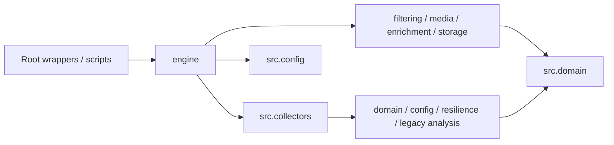

# Kế hoạch refactor và migration map

> **Snapshot lịch sử theo ngày trong tài liệu.** Các trạng thái “chưa triển khai”, disabled hoặc lỗi probe chỉ áp dụng cho lượt kiểm tra đó. Đối chiếu code/config hiện hành ngày 11/10/2026 tại [trạng thái dự án](current-state.md); không dùng snapshot này để kết luận runtime hiện tại.

Ngày: **08/10/2026**. Trạng thái: đề xuất dựa trên [audit](current-architecture-audit.md) và baseline đã pass; **chưa di chuyển file**.

## 1. Mục tiêu và invariant Phase 1

Phase 1 phân ownership vào `specs/`, `docs/`, `src/`, `engine/` và giữ functional outputs của legacy. Schema/taxonomy/config SmartCity, classifier, source mới và thay đổi media/dedup behavior bắt đầu sau structural gate.

Các invariant phải giữ: CLI cũ, JSON keys/capitalization, record IDs, output/input/log/session/DB paths, env precedence, default en/fa, Whisper task, discovery caps/query semantics, sorting, duplicate skip/tag policy, Telegram edit refresh, retry/cooldown và null models. Không rename data directory, SQLite table hoặc đổi hash/threshold trong cùng structural patch.

Baseline evidence: [demo](baseline/demo.json), [manifest](baseline/manifest.json), [dependency snapshot](baseline/dependencies.txt). Mỗi migration patch phải có một responsibility và chạy lại checks thích hợp; không trộn move + collector rewrite + LLM + schema.

## 2. Cấu trúc target có ownership thực

`src` và `engine` dự kiến là Python packages có `__init__.py`; root launcher tiếp tục chạy từ Git root như hiện tại. Đây là lựa chọn repo-local nhằm giữ workflow; packaging qua `pyproject.toml` phải khai báo rõ các package, không dựa vào auto-discovery cả data/tests.

```text
social_media_scraping/                    giữ Git root/tên thư mục hiện tại
  README.md                              cập nhật hướng dẫn, giữ legacy commands
  pyproject.toml                         package metadata/check configuration
  .env.example                           secrets/runtime legacy placeholders
  *-scraper.py                           compatibility CLI wrappers
  pipeline_utils.py                      compatibility facade
  dedup_utils.py                         alias tới module dedup duy nhất
  demo.py                                compatibility offline demo
  selfcheck_schema.py                    wrapper tới checks đã migration
  selfcheck_twtr_retry.py                 wrapper tới checks đã migration
  run-scrapers.sh                         Linux launcher giữ command/lock
  requirements*.txt                      giữ dependency tiers trong Phase 1
  specs/
    README.md                            ownership/version/change procedure
    product/{prd,scope}.md
    contracts/{legacy-record,source-adapter,canonical-record,
               unified-evidence,llm-output}.md
    taxonomy/{domains,site-access-congestion,customer-complaint}.md
    traceability/requirements-matrix.md
  docs/
    current-architecture-audit.md
    prd-to-code-gap-analysis.md
    refactor-plan.md
    implementation-plan.md
    refactor-summary.md                  tạo khi structural gate đạt
    baseline/{demo.json,dependencies.txt,manifest.json}
    architecture/                        explanation/data flow/decisions
    operations/                          scheduling/failures/runbook
    decisions/                           ADRs gắn evidence/compatibility
  src/
    config/{env,paths,loader,validation}.py
    resilience/{retry,rate_limit}.py
    observability/logging.py
    domain/{language,legacy_schema,normalization,models,enums,schemas}.py
    analysis/legacy_text.py               financial assets + sentiment/NLI state
    discovery/{keyword_matching,query_builder,keyword_search,watchlist}.py
    collectors/
      base.py
      x/collector.py
      youtube/{collector,adapter}.py
      telegram/collector.py
      reddit/collector.py
      tiktok/{collector,adapter}.py
      truthsocial/collector.py
      facebook/adapter.py
      web/adapter.py
    media/{transcription,audio,resolver,frames,vision}.py
    filtering/{dedup,exclusion,relevance}.py
    storage/{record_file,database,repositories}.py
    storage/migrations/
    enrichment/{llm,prompts,validation,tagging}.py
    export/excel.py
    compat/pipeline.py                   re-export facade, không duplicate logic
  engine/
    legacy/{x,youtube,telegram,reddit,tiktok,truthsocial}.py
    legacy/demo.py                       compose shared utilities cho demo
    runtime.py                           legacy dispatch trước, SmartCity CLI sau
    {pipeline,scheduler,source_registry,crawl_run,orchestration}.py
  config/{sources,keywords,exclusions,taxonomy,schedule}.yaml
  tests/
    unit/                                shared behavior, config, filter, media
    integration/                         pipeline/storage/export/failure fixtures
    contract/                            adapter/schema/dependency compatibility
    fixtures/                            synthetic/authorized redacted samples
  scripts/{run_pipeline,run_collector,export_excel}.py
  data/.gitkeep                          generated SmartCity artifacts sau này
  examples/                              giữ starter inputs legacy
  assets-registry/                        giữ financial registry template
```

Tree trên là **target qua nhiều phase**. Phase 1 chỉ tạo module có legacy implementation/migration use case; không tạo `base.py`, Facebook/Web adapter, canonical model, LLM/Excel, YAML hoặc scheduler rỗng để trông như đã có feature. Legacy runtime trong engine phải có code compose collector thật, không chỉ folder rỗng.

| Vùng | Owner/responsibility | Không thuộc vùng |
| --- | --- | --- |
| `specs/` | Product/Data contract owners: requirement, taxonomy, schemas, acceptance/version | Parsing/SQL/scheduling code |
| `docs/` | Engineering/Ops: audit, architecture, migration, feasibility, runbook, ADR | Duplicate nguyên văn contract |
| `src/` | Engineering/Data components: acquisition, config parsing, domain, filtering, media, enrichment, storage, export | Scheduler, crawl-run lifecycle hoặc flow nghiệp vụ cấp cao |
| `engine/` | Runtime owner: config composition, run/source orchestration, invocation, status aggregation | Platform HTML parsing, prompt text, business SQL |

`collector.py` chịu trách nhiệm acquisition của một source/batch, không chọn lịch hoặc toàn bộ project flow. Loops cục bộ pagination/parse/fetch một source ở src; vòng toàn watchlist, retry pass qua account list và CLI startup thuộc engine.

## 3. File migration map

| Existing file | Target implementation | Compatibility/import impact | Thời điểm |
| --- | --- | --- | --- |
| `pipeline_utils.py` | Tách symbol groups ở §4; `src/compat/pipeline.py` re-export | Root facade giữ supported public imports; private state tests chuyển tới owner module | Phase 1, từng nhóm nhỏ |
| `dedup_utils.py` | `src/filtering/dedup.py`, ban đầu giữ nguyên SQLite helpers | Root import alias cùng module object, không copy `DB_PATH`/index state | Phase 1 trước collectors |
| `twtr-scraper.py` | `src/collectors/x/collector.py`; `main`, `_scrape_account_list` → `engine/legacy/x.py` | Root CLI wrapper; self-check import actual collector/runtime owners | Phase 1 từng collector |
| `yt-scraper.py` | `src/collectors/youtube/collector.py`; `main` → `engine/legacy/youtube.py` | Root CLI wrapper; giữ fetch/filter/write và preload order | Phase 1 |
| `tel-scraper.py` | `src/collectors/telegram/collector.py`; `run`, `main` → `engine/legacy/telegram.py` | Root CLI wrapper; giữ async session/flood semantics | Phase 1 |
| `reddit-scraper.py` | `src/collectors/reddit/collector.py`; `main` → `engine/legacy/reddit.py` | Root CLI wrapper; giữ PRAW init/read-only và default inputs | Phase 1 |
| `tiktok-scraper.py` | `src/collectors/tiktok/collector.py`; `main` → `engine/legacy/tiktok.py` | Root CLI wrapper; giữ first matched keyword và duplicate tagging | Phase 1 |
| `truth-scraper.py` | `src/collectors/truthsocial/collector.py`; `main` → `engine/legacy/truthsocial.py` | Root CLI wrapper; giữ login/caps/paging và process-local auth | Phase 1 |
| `demo.py` | `engine/legacy/demo.py` | Root wrapper vẫn stdout JSON; compare parsed output | Phase 1 sau shared modules |
| `selfcheck_schema.py` | `tests/contract/legacy_schema.py` | Root wrapper; chỉ cập nhật import/patch owner, giữ mọi assertions/data | Phase 1 cùng ownership thay đổi |
| `selfcheck_twtr_retry.py` | `tests/integration/legacy_x_retry.py` | Root wrapper; bỏ dynamic import đường dẫn hyphen script, dùng actual collector + runtime modules | Phase 1 cùng X migration |
| `run-scrapers.sh` | Giữ tại root | Giữ process isolation/order/flock/stdin/exit; command cũ chạy wrapper | Phase 1 không replace |
| `requirements*.txt` | Giữ; pyproject metadata bổ sung | Không upgrade/downgrade dependency khi move; tránh hai dependency sources lệch nhau | Phase 1 |
| `.env.example`, examples, asset template | Giữ vị trí/behavior | Không thay en/fa/Whisper/default source để làm SmartCity trong refactor | Phase 1 |
| `.github/workflows/ci.yml` | Giữ CI, mở recursive first-party compile/import checks | Root-only `*.py` không đủ sau move; exclude `.venv`/third-party | Phase 1 |
| PRD tại thư mục cha | Copy versioned snapshot sang `specs/product/prd.md` | Giữ nguyên original file; SHA/content và provenance rõ, không rewrite requirement | Phase 1 documentation |

Không xóa wrapper trong Phase 1. Deprecation/removal chỉ khi new path pass, downstream không còn dùng, migration documented và compatibility đã kiểm chứng; bỏ alias phải là thay đổi riêng.

## 4. Shared symbol migration map

| Symbol group/source trong `pipeline_utils.py` | Owner target | Dependency/state cần giữ |
| --- | --- | --- |
| `load_dotenv`, `_env_raw/_env_parsed`, `env_str/int/float/bool/set/range`, `get_scrape_mode` | `src/config/env.py` | One-time `.env` load; same prefixed/shared resolution và default-on-invalid |
| `LOG_DIR`, `KEYWORDS_DIR`, `SOURCES_DIR`, `ASSETS_REGISTRY_DIR`, `DEDUP_DIR`, `SESSIONS_DIR`, registry path | `src/config/paths.py` | Giữ relative CWD semantics; không đổi path sang `__file__` trong move |
| `setup_logging` | `src/observability/logging.py` | One root configuration flag; model/library levels và shared logger names được kiểm tra |
| `with_retry` | `src/resilience/retry.py` | Exception tuples/max attempts/backoff/jitter/functools metadata |
| `RateLimiter` | `src/resilience/rate_limit.py` | One lock/clock state mỗi limiter; không nhân limiter khi re-export |
| `_identifier`, `detect_language`, `is_english`, `language_allowed` | `src/domain/language.py` | Same py3langid model/probability; null/low confidence behavior |
| `TIMESTAMP_FMT`, `parse_record_timestamp`, `RecordFile` | `src/storage/record_file.py` | Existing lazy load/sort/add/save semantics; direct collector merges chưa thay thế |
| `keyword_matches` | `src/discovery/keyword_matching.py` | Token-wise casefold substring behavior legacy |
| Financial registry, alias/cashtag/NLI/sentiment helpers, `analyze_text`, `_split_nli_premise`, model/cache globals | `src/analysis/legacy_text.py` | Một owner cho caches/locks/model bundles; gom financial concern trước, không đổi thuật toán hoặc tải models trong CI |
| Platform/content constants, `_valid_*`, quality checks và `build_quality` | `src/domain/legacy_schema.py` | Giữ six-platform validator/scoring; sentiment label map dùng chung owner/read-only dependency |
| Whisper settings/state/model/circuit-breaker, `get_whisper_model`, `_record_whisper_env_failure`, `_download_audio`, `transcribe_audio` | `src/media/transcription.py` | Ban đầu giữ chain audio+ASR cùng owner; tách audio backend ở Phase 5 khi resolver cần |

Financial analysis vẫn tương đối lớn nhưng có một responsibility rõ; việc tách asset/sentiment thêm chỉ làm khi tests bảo vệ shared chunking/model state. Không chuyển toàn monolith sang `src/utils.py` rồi tuyên bố hoàn thành.

## 5. Dependency direction



Quy tắc kiểm tra bằng AST/import tests:

1. `engine → src` được phép; **`src → engine` cấm**, kể cả import local trong hàm.
2. `src` không phụ thuộc root compatibility wrappers hoặc tests.
3. Domain models/enums/normalization không import collector/provider/storage/engine. Legacy schema có thể đọc financial label constants nhưng không chạy NLP; tách read-only schema constants nếu cần tránh cycle.
4. Config parsing không tự chạy collector/scheduler; runtime composition thuộc engine.
5. Media resolver không gọi enrichment; enrichment nhận evidence và không fetch raw media.
6. SQL/transactions thuộc storage, prompt thuộc enrichment, platform-specific parse thuộc collector.
7. Legacy financial analysis độc lập với SmartCity enrichment; không đổi asset registry thành project dictionary ngầm.

## 6. Compatibility traps và cách kiểm chứng

- **Mutable globals:** demo và X self-check gán `dedup_utils.DB_PATH`. `from new_module import *` làm hai binding tách nhau; facade dedup phải alias đúng owner. Có test đổi DB_PATH từ import cũ và kiểm tra DB thực tế nằm tại temp path.
- **Monkeypatch namespace:** schema self-check patch `pipeline_utils.analyze_sentiment`, `extract_asset_mentions` và private `_ASSET_NLI_MODEL_NAME`; X patch helper functions. Sau split, patch vào module nơi function lookup thực sự diễn ra. Chỉ đổi import/patch target, không xóa/nới assertions. Supported public API được kiểm tra riêng qua facade; không cam kết arbitrary write vào private globals facade.
- **Import side effects:** giữ thứ tự dotenv/config/logger/model initialization và subprocess isolation trước; import smoke không gọi main hoặc tải model. Không import mọi collector eager từ `__init__`.
- **Logger names:** functions move làm `func.__module__` đổi tên; logger config cần vẫn nhận shared warning/INFO. Assert relevant log message/handler counts thay vì timestamp/module path byte equality.
- **Cutoff/time:** freeze injected/mock clock trong characterization, compare `published_at`, sort order và window inclusion; không đổi default cutoff behavior.
- **Paths/CWD:** root CLI phải hoạt động theo workflow cũ; engine không âm thầm chdir hoặc tạo data mới. Linux runner giữ cwd/root lock; direct script ngoài root giữ documented legacy relative-path limitation.
- **Collector startup:** auth/model/client init trong engine ở cùng thứ tự; giữ dynamic `get_scrape_mode` và import-time constants cho legacy. Thay bằng typed per-run config là Phase 2/3, không lẫn structural move.
- **Failure API:** giữ `None`/path/list/tuple/normal-return legacy trong Phase 1. Structured outcomes mới thuộc adapter contract sau gate.

## 7. Thứ tự migration có gates

| Bước | Thay đổi | Gate trước khi đi tiếp |
| --- | --- | --- |
| 0 | Freeze baseline HEAD/dependencies/demo; characterization cho uncovered behavior | Hai self-check, demo, import/compile/shell PASS; fixtures có fixed time/temp DB |
| 1 | Tạo package roots/ownership specs/docs; ghi legacy-record contract | Không feature, không thay JSON/data paths |
| 2 | Tách env/paths/language và shared resilience/logging | Config precedence, no-terminal mode, language/null, rate/retry/logger parity |
| 3 | Move dedup; tách legacy schema/text/media/RecordFile từng patch | Old/new import identity, DB_PATH/state parity, same demo JSON |
| 4 | Move collector đầu tiên YouTube, rồi TikTok, X, Telegram, Reddit, Truth | Characterization từng collector pass trước/sau; startup loops tách ở patch riêng |
| 5 | Tách `main`/whole-watchlist orchestration vào `engine/legacy`; root wrappers | CLI exit/error behavior, X retry tests, no src→engine; process isolation |
| 6 | Migration demo/self-check ownership và CI imports/recursive compile | Root commands còn pass; new commands/CI cả 3.12/3.13 |
| 7 | Document final map/deprecated paths/state/remaining debt | `docs/refactor-summary.md`; không duplicate implementation; Phase 1 checklist đạt |
| 8 | Bắt đầu canonical/registry/SmartCity behavior phases | Structural gate đã hoàn tất, business deltas tách riêng |

Nếu một bước cần temporary compatibility facade/transition module thì ghi owner và cleanup gate trong patch. File collector ban đầu có thể relocation nguyên khối để chứng minh parity; sau đó extract runtime ở bước riêng, **không coi Phase 1 complete khi src còn flow cấp cao**.

Step 9 của migration strategy đính kèm (bỏ deprecated entrypoints sau verification) không bắt buộc xóa script vẫn hữu ích. Quyết định giữ wrappers giảm impact và được đưa vào refactor summary.

## 8. Test map bảo vệ structural phase

| Coverage | Existing evidence | Characterization cần thêm trước move tương ứng |
| --- | --- | --- |
| Shared schema/config/language/JSON | `selfcheck_schema.py` đã pass | Env malformed/prefix, no-TTY, saved JSON/order/empty save, facade public signature/null behavior |
| X retry/fallback | Tám cases `selfcheck_twtr_retry.py` đã pass | New collector/runtime import ownership, root CLI compatibility, prefetched/fetched duplicate/write behavior |
| Demo | Ba synthetic records, saved baseline | Compare parsed JSON; old/new command; dedup temp DB override identity |
| Dedup | Demo exact case + probes audit | Exact/near/self/edit/reload; fixed MinHash settings; empty-key current behavior freeze riêng với known debt |
| YouTube | Chưa direct suite | Mock metadata/transcript; cutoff, skip-no-text, skip duplicate, channel/search/cap semantics, old JSON append |
| TikTok | Chưa direct suite | Mock VTT/ASR/description/no-text; pinned old video continue; keyword-first bucket; duplicates retained; rerun |
| Telegram | Chưa direct suite | Fake client/messages; min_id mode, edited refresh, FloodWait bounds, textless skip, duplicate retained |
| Reddit | Chưa direct suite | Fake submissions; title/body, time filter, score clamp, duplicates skipped, missing credentials normal-return |
| Truth | Chưa direct suite | Fake response/status; retryable/permanent HTTP, partial pages, reblog identity/content split, media-only placeholder |
| Dependency/import/runtime | Sáu fresh-process imports + compile + Bash syntax | AST cấm src→engine/root wrapper; no eager main/network/model download; one process per legacy collector |

Tests mới ở bảng này **chưa được viết trong lượt audit**. Khi viết, test observable outputs/side effects và failure paths; không test chỉ để mirror line-by-line implementation. Không dùng Facebook/TikTok live trong CI.

## 9. Rollback và Definition of Done

Rollback structural theo từng patch/phase về baseline; dữ liệu và input directory không đổi nên không cần migration ngược DB/JSON. Không dùng destructive reset với user changes; revert patch phù hợp. Feature migrations additive sau này cần version/backup riêng, không nằm trong structural rollback.

Phase 1 chỉ hoàn tất khi bốn vùng có nội dung/ownership thực; src component và engine runtime có implementation; toàn bộ legacy checks/demo/new imports/characterization pass; config helpers đã tách mà behavior giữ; dependency rule pass; wrappers hoạt động; không duplicate algorithms/state; summary có file/import map và debt. Test pass một runtime chưa chứng minh toàn bộ CI matrix: phải ghi rõ runtime đã verified.

Lượt hiện tại chỉ tạo tài liệu và lưu baseline artifacts. Không git commit, move, delete, feature implementation hoặc claim Phase 1 complete.
