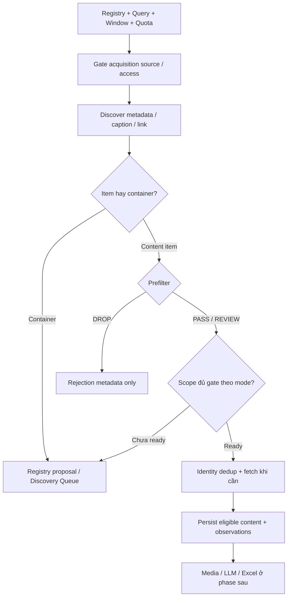

# Source Adapter và acquisition candidate v1

**Threads PLANNED:** [adapter Threads](../features/threads-adapter.md) tái sử dụng boundary access/discover/fetch và bổ sung replies, nhưng đi theo raw-before-filter với [contract đa nền tảng](multi-platform-conversations.md). Candidate enum/Registry/runtime hiện chưa hỗ trợ Threads; không áp prefilter-before-persist v1 cho raw Threads.

**Increment raw v2 đã triển khai:** [group tracing](../features/facebook-group-tracing.md) mở rộng acquisition sang comment/reply và inventory bài cũ qua [dashboard bridge](../../docs/operations/dashboard-raw-v2.md). Candidate v1/post-only trong contract này không thay [conversation-record-v2](conversation-record.md). Scan/checkpoint/outcome và raw-before-filter áp dụng mode v2; acquisition v1 giữ policy riêng. Full live coverage/ACP còn pending.

Ngày: **08/10/2026**. Contract: `source-adapter-contract-v1`; payload: `acquisition-candidate-v1`. Đã có typed models/adapters/runtime và kiểm thử offline theo [implementation report](../../docs/acquisition-implementation.md). Chưa ACP/LIVE_VERIFIED toàn luồng; các case acceptance phía dưới vẫn cần đối chiếu với evidence riêng.

Áp dụng cho [Facebook group](../features/facebook-adapter.md), [TikTok search](../features/tiktok-search.md) và [Google social discovery](../features/google-social-discovery.md). Ràng buộc nguồn ở [Source Registry](source-registry.md); rule ở [Exclusion](exclusion-rules.md); nguồn mới ở [Discovery Queue](discovery-queue.md). PRD liên quan: FR-01/02/04/05/06/12/16/17.

## 1. Boundary và trách nhiệm

- `src` sở hữu interface/types, browser/parser/provider, normalization và prefilter components. `engine` sở hữu registry, run/window, dispatch, gọi prefilter, persistence và source isolation. Chỉ cho phép dependency `engine → src`.
- `discover` chỉ lấy thông tin tối thiểu cần thiết để tạo candidate; `fetch_item` lấy text/metadata đầy đủ khi được dispatch. Tải video/audio, ASR, OCR/vision, LLM và Excel là các bước sau, không có side effect ngầm từ hai operation này.
- Reuse primitives TikTok/YouTube sau structural refactor và compatibility gate ở [implementation plan](../../docs/implementation-plan.md). Không thay output/CLI của sáu collector legacy bằng candidate schema này.
- Không coi kết quả Google là platform content; payload Google là `SEARCH_SNIPPET`. `PASS` từ prefilter không phải relevance `KEEP`. Acquisition không tạo operational domain/confidence hoặc suy đoán project/location.
- Candidate text tạm được đọc trước prefilter. Chỉ persist payload sau prefilter; DROP rõ intent chỉ persist rejection metadata theo exclusion contract. Quy tắc này làm rõ bước “persist raw trước enrichment” trong kế hoạch cũ: persist xảy ra **sau** prefilter.



TikTok direct search dùng gate query scope đã duyệt; Google target-item fetch còn cần gate nguồn đích. Container đã có registry có thể chỉ attach discovery observation; không dispatch full listing từ Google job hoặc tạo content record.

## 2. Interface và input

Các signature dưới đây là contract ký hiệu, chưa phải API/code hiện có:

| Operation | Input | Output / side effects được phép |
| --- | --- | --- |
| `probe_access(source)` | Registry source, access/profile/credential reference, bounded timeout | `AccessProbeResult`: trạng thái, observed public/login state, checked time và lý do; không tự bật source hoặc tự xác nhận curator approval |
| `discover(request)` | `DiscoveryRequest` | `CandidateBatch`: candidates tạm, outcomes/counters/coverage; không persist raw hoặc tải media |
| `fetch_item(candidate, context)` | Candidate PASS/REVIEW; `FetchContext` có source đã đủ điều kiện, window và remaining budget | `FetchResult`: candidate bổ sung text/metadata, item status và lỗi; không fetch candidate DROP |

`DiscoveryRequest` phải có `crawl_run_id`, `source_id`, source snapshot/config version, `lookback_start`, `lookback_end`, acquisition mode và quota. Query job còn có `query_id`, `query_type`, `search_keyword` original và query gửi thực tế. `FetchContext` giữ original observation lineage; `source_id` acquisition không bị overwrite bằng nguồn đích khi routing từ Google.

| Mode | Query type | Target |
| --- | --- | --- |
| `RECENT_SOURCE_ITEMS` | null | Facebook group đã duyệt |
| `KEYWORD_SEARCH` | `KEYWORD` | TikTok video search theo query đã duyệt |
| `HASHTAG_SEARCH` | `HASHTAG` | TikTok hashtag page/feed theo query đã duyệt |
| `SOCIAL_LINK_DISCOVERY` | `KEYWORD` hoặc `HASHTAG` | Google tìm URL Facebook/TikTok/YouTube |

`AccessProbeResult` phân biệt `ACCESSIBLE`, `AUTH_REQUIRED`, `ACCESS_DENIED`, `SOURCE_UNAVAILABLE`, `RATE_LIMITED`, `EXTRACTION_FAILED`. Một probe thành công không chứng minh mọi bài trong group accessible, và không thay `enabled`/`verification_status`/`access_verified` của curator. Source disabled chỉ được probe qua tác vụ kiểm chứng được operator gọi rõ ràng; không tự probe khi dispatch crawl.

## 3. Candidate schema

Đây là schema acquisition, không phải canonical enrichment schema hoặc output JSON legacy. Mọi object có các key bên dưới; nullable được quy định cụ thể. Dữ liệu không lấy được giữ null/empty với lý do, không fabricate để làm bản ghi complete.

| Field | Type / rule |
| --- | --- |
| `schema_version` | String, `acquisition-candidate-v1` |
| `candidate_id` | Nonempty opaque ID của observation; dùng để trace trước khi canonicalize, không thay native item ID |
| `candidate_kind` | `CONTENT_ITEM` hoặc `SOURCE_CONTAINER`; container không tạo content record giả |
| `platform` | `facebook`, `tiktok`, `youtube`: nền tảng đích của URL, kể cả khi Google phát hiện |
| `platform_item_id` | String hoặc null; null cho container/URL chưa resolve; ID số giữ string |
| `source_url` | URL đích gốc, không phải Google redirect hoặc URL API có key |
| `canonical_url` | HTTPS URL đã normalize, identity-preserving; không truy cập nguồn ngoài allowlist để normalize |
| `source_id` | Registry source tạo acquisition job; với Google là source search của Google, không phải group/channel được phỏng đoán |
| `origin_source_ref` | Nullable group/profile/channel reference khi đã xác định; chưa biết không đoán từ title/snippet |
| `target_source_id` | Nullable registry source nguồn đích đã resolve; Google có thể null cho tới lúc duyệt |
| `crawl_run_id` | ID run hiện tại |
| `query_id`, `query_type`, `search_keyword` | Nullable với group recent mode; bắt buộc với query job; keyword original được giữ nguyên |
| `effective_query` | Nullable string: query/hashtag đã gửi thực tế; Google giữ đầy đủ `site:` query |
| `discovered_via` | `FACEBOOK_GROUP_BROWSER`, `TIKTOK_KEYWORD_BROWSER`, `TIKTOK_HASHTAG_BROWSER`, `GOOGLE_SERPAPI` |
| `title`, `caption`, `search_snippet` | Nullable strings; snippet Google tách khỏi caption bài; không copy snippet vào full text |
| `hashtags` | List strings original; [] khi không thấy, kèm missing reason nếu extraction chưa có |
| `author` | Object: `platform_author_id`, `display_name`, `profile_url`, mỗi field nullable; chỉ dữ liệu hiển thị cần thiết |
| `engagement` | Object: `views`, `likes`, `comments`, `shares`; mỗi field nullable nonnegative integer; null khác 0 |
| `media_refs` | List metadata/URLs có `media_type`; [] hợp lệ; link không chứng minh tải media thành công |
| `published_at` | Nullable ISO-8601 UTC timestamp; chỉ đặt khi quy đổi được thời gian đăng đủ chính xác |
| `publication_precision` | `INSTANT`, `APPROXIMATE`, `DATE_ONLY`, `UNKNOWN`; khác INSTANT không giả timestamp chính xác |
| `published_time_raw`, `publication_date` | Nullable original label và ISO date hỗ trợ provenance; chỉ giữ text của time label, không HTML cả trang |
| `window_status` | `IN_WINDOW`, `OUT_OF_WINDOW`, `UNKNOWN`; chỉ INSTANT trong khoảng được IN_WINDOW |
| `discovered_at`, `collected_at` | ISO-8601 UTC; thời điểm phát hiện và thu candidate, không thay published time |
| `prefilter_decision` | null trước filter, sau filter `PASS`, `DROP`, `REVIEW` |
| `rule_id`, `drop_reason` | Nullable strings; DROP bắt buộc có rule/reason code; reason không chứa raw text |
| `extraction_status` | `DISCOVERED`, `FETCHED`, `METADATA_ONLY`, `EXTRACTION_FAILED` |
| `missing_data_reasons` | List reason codes cho text/time/metric/evidence chưa có |
| `evidence_provenance` | List loại/method của evidence đã lấy; Google snippet phải ghi `SEARCH_SNIPPET` |

`FetchResult` bổ sung `raw_text` (nullable, original UTF-8), content type và method/provenance; giữ caption/snippet riêng. Bài không text được `METADATA_ONLY` + missing reason + prefilter REVIEW, không biến thành empty DROP. Chưa có media processing thì không ghi transcript/OCR/visual summary giả.

Ví dụ **synthetic**, chưa crawl hoặc resolve nguồn này thực tế:

```json
{
  "schema_version": "acquisition-candidate-v1",
  "candidate_id": "obs_demo_tt_01",
  "candidate_kind": "CONTENT_ITEM",
  "platform": "tiktok",
  "platform_item_id": "7000000000000000001",
  "source_url": "https://www.tiktok.com/@demo/video/7000000000000000001",
  "canonical_url": "https://www.tiktok.com/@demo/video/7000000000000000001",
  "source_id": "tt_search_vincons",
  "origin_source_ref": "demo",
  "target_source_id": null,
  "crawl_run_id": "run_demo_01",
  "query_id": "q_demo_vincons_keyword",
  "query_type": "KEYWORD",
  "search_keyword": "VinCons",
  "effective_query": "VinCons",
  "discovered_via": "TIKTOK_KEYWORD_BROWSER",
  "title": null,
  "caption": "Cổng công trường VinCons đông, công nhân chờ vào #VinCons",
  "search_snippet": null,
  "hashtags": ["#VinCons"],
  "author": {"platform_author_id": null, "display_name": "demo", "profile_url": "https://www.tiktok.com/@demo"},
  "engagement": {"views": null, "likes": 0, "comments": null, "shares": null},
  "media_refs": [],
  "published_at": "2026-10-08T00:30:00Z",
  "publication_precision": "INSTANT",
  "published_time_raw": null,
  "publication_date": null,
  "window_status": "IN_WINDOW",
  "discovered_at": "2026-10-08T01:00:00Z",
  "collected_at": "2026-10-08T01:00:01Z",
  "prefilter_decision": "PASS",
  "rule_id": null,
  "drop_reason": null,
  "extraction_status": "DISCOVERED",
  "missing_data_reasons": ["ENGAGEMENT_PARTIAL", "MEDIA_NOT_RESOLVED"],
  "evidence_provenance": ["TIKTOK_BROWSER_CAPTION"]
}
```

## 4. Window, ordering, identity và persistence

- `lookback_start < lookback_end`, timezone-aware, window `[start, end)`. Một run chốt end một lần; mặc định start = end − 180 phút. Rerun dùng lại window explicit, tạo run ID mới.
- Published INSTANT ngoài window được tính out-of-window, không fetch tiếp/persist content mới. Unknown/approximate/date-only có thể fetch để resolve trong budget; vẫn UNKNOWN thì persist metadata/evidence eligible với REVIEW và loại khỏi số fresh items confirmed.
- Không dừng vì một bài cũ nếu listing pinned/relevance/mixed. Ghi `observed_order=LATEST|RELEVANCE|MIXED|UNKNOWN`; chỉ kết luận window exhausted khi có bằng chứng thứ tự phù hợp. Google time hint không thay platform publication.
- Identity canonical: platform + native item ID; fallback platform + canonical item URL. Container có identity riêng cho queue/registry. Candidate ID hoặc acquisition source ID không thay identity nội dung.
- URL normalization giữ identity params như YouTube `v`, Facebook `story_fbid`/`id`; loại tracking, fragment và host aliases đã xác định. Short URL chưa resolve để pending; resolve có giới hạn ba redirects và chỉ target platform allowlist. Không merge URL mơ hồ thành cùng item.
- Một item nhiều query/run có một content record và nhiều observations chứa source/run/query/method; fetch từ Google còn giữ target source riêng. Không overwrite query đầu bằng query cuối.
- Persist candidate eligible và observation trước media/LLM; resume processing từ state đã lưu. DROP ở prefilter chỉ giữ bảy audit fields theo exclusion contract, không serialize candidate text vào batch log/file/queue/DB.
- Content hash chỉ tính khi có normalized text hữu ích. Empty/emoji-only không dùng hash để merge unrelated items. Near duplicate chỉ là relationship, không tự kết luận cùng incident.

## 5. Batch outcome, coverage và monitoring

`CandidateBatch`/`FetchResult` trả typed outcome, không dùng `[]`/`None` làm tín hiệu chung cho mọi lỗi. Outcome có source/run/query ID, status, error code sanitized, attempts, elapsed time, counters, stop reason và coverage flags. Kết quả đã filter/persist được giữ nếu job lỗi sau đó.

| Status | Ý nghĩa / hành vi |
| --- | --- |
| `SUCCESS` | Job hoàn thành theo giới hạn cấu hình; cap có thể đạt, nhưng phải ghi coverage limited |
| `NO_NEW_DATA` | Enumeration/extraction thành công, không có item mới; ghi rõ empty thật, toàn trùng hoặc toàn ngoài window |
| `PARTIAL` | Đã có kết quả hữu ích rồi lỗi/timeout; giữ chúng, error code chỉ rõ nguyên nhân |
| `AUTH_REQUIRED` | Cần đăng nhập hoặc phiên hết hạn, chưa có kết quả hữu ích |
| `ACCESS_DENIED` | Private hoặc quyền từ chối; dừng job |
| `RATE_LIMITED` | Hết retry/budget sau limit; không spin loop |
| `SOURCE_UNAVAILABLE` | Nguồn không tồn tại/không truy cập được |
| `EXTRACTION_FAILED` | UI không parse được hoặc response invalid, không phải empty success |
| `BUDGET_EXHAUSTED` | Quota API/run deadline hết trước khi có kết quả; không tự nâng gói |
| `SKIPPED` | Disabled/unverified/outside supported scope/profile đang khóa; không dispatch crawl |

`NO_NEW_DATA` không dùng cho job có candidate mới bị DROP/queue: job đó SUCCESS và counters giải thích routing. Nếu cap đạt nhưng không thể biết còn item mới, ghi `coverage_limited=true`; không tuyên bố complete platform/window coverage.

Counters tối thiểu: candidates discovered, items unique, new/existing, out-of-window, unknown time, prefilter PASS/DROP/REVIEW, queued, fetch successful/failed, API attempts, source duration. Counts từ processing thật; `prefilter_pass_count` không được gọi `KEEP_count`. Media/LLM/export chưa chạy giữ NOT_RUN, không báo successful.

Run lifecycle riêng `RUNNING|SUCCESS|PARTIAL|FAILED`: một source fail không hủy source khác; có successful job và failed/skipped-unready job thì PARTIAL; không job eligible thì FAILED/NO_ELIGIBLE_SOURCE. Skip source disabled chủ ý không làm run lỗi. Toàn jobs thành công có thể SUCCESS với coverage flags nếu các caps được tuân thủ.

## 6. Browser/session và default budget

| Setting | Pilot default |
| --- | --- |
| Execution / platform | CLI manual; Windows/Python 3.13 baseline |
| Browser | Playwright Chromium; headless khi crawl |
| Session | Profile Facebook và TikTok riêng dưới `sessions/`; một active job/profile |
| Authentication | Lệnh bootstrap interactive do operator gọi; đăng nhập thủ công, không nhận mật khẩu trong config |
| Candidate cap | Facebook 100/group; TikTok 50/query |
| Source/query timeout | 120 giây, bao gồm listing/fetch/retry của job |
| Run deadline | 1.200 giây, bao gồm acquisition/routing jobs |
| Retry | Tổng tối đa hai attempts cho lỗi tạm thời, trong cùng deadline |
| Google | Một trang/query; 20 request/run; 200 request/tháng |
| Optional deep processing | Comments/media download/ASR/LLM tắt ở acquisition pilot |

Source timeout không reset cho từng item. Timeout/5xx/network mới retry bounded; auth/private/CAPTCHA/parser mismatch/config invalid không auto retry. Không retry request bị timeout nếu job/run deadline đã hết. Browser crawl không tự bật cửa sổ login; ghi AUTH_REQUIRED để operator bootstrap lại.

Lock scope gồm profile và source/window; khóa được release và context đóng ở mọi exit path. Profile đang sử dụng được SKIPPED/PROFILE_IN_USE; operator rerun sau. Không dùng default Chrome profile. Session state nằm trong [thư mục ignore đã có](../../.gitignore), tránh lưu vào fixtures hoặc log; tham khảo [Playwright authentication](https://playwright.dev/python/docs/auth). Screenshots/HTML/trace tự động tắt vì có thể giữ raw text của DROP; evidence pilot được redacted chọn riêng.

Không tự join group, đổi quyền, giải CAPTCHA, stealth, xoay proxy để vượt block hoặc reverse-engineer private endpoints. Public source cần login vẫn được xử lý khi có public verification; có session không làm private source thuộc phạm vi.

## 7. Acceptance chung và evidence

Tất cả case dưới đây **PLANNED**, chưa là runtime tests đã pass. Test owner: Engineering/QA; live evidence: Ops + Engineering.

| Case ID | Input/scenario | Expected | PRD |
| --- | --- | --- | --- |
| AD-AC-01 | Disabled/unverified source | Không crawl; SKIPPED và reason; explicit probe không enable nguồn | FR-01/16 |
| AD-AC-02 | Item đúng start, đúng end, missing/date-only time | Start included, end excluded; UNKNOWN không tính fresh confirmed | FR-04/17 |
| AD-AC-03 | Item cũ pinned đứng trước item mới | Không bỏ phần listing mới; observed order/stop reason rõ | FR-04 |
| AD-AC-04 | Cùng item qua hai query và rerun | Một content record; observations đủ source/query/run | FR-05/12/17 |
| AD-AC-05 | Sales/recruitment/đổi hàng rõ | DROP chỉ audit; fetch/media/LLM/persist raw không được gọi | FR-06 |
| AD-AC-06 | Complaint/mixed intent/video không caption | REVIEW hoặc PASS phù hợp; không auto-DROP/KEEP theo keyword | FR-06 |
| AD-AC-07 | Empty list thật và selector/parser mất | NO_NEW_DATA khác EXTRACTION_FAILED | FR-04/16 |
| AD-AC-08 | Có item rồi auth/timeout; source tiếp theo healthy | Giữ kết quả; PARTIAL; source sau vẫn chạy | FR-16 |
| AD-AC-09 | Hai job dùng một profile; exception khi fetch | Job thứ hai không launch cùng profile; release lock/context | FR-16/17 |
| AD-AC-10 | Crash sau persist rồi rerun | Không trùng canonical; state/observation resumable | FR-05/17 |
| AD-AC-11 | Empty/emoji-only text hai ID khác | Không merge bằng empty hash | FR-12 |
| AD-AC-12 | Candidate chứa secret-like values trong provider errors | Sanitized logs; không URL API key/session/HTML raw | NFR security |

Live feasibility thực hiện sớm; structural refactor baseline phải pass trước feature integration. Offline fixtures không thay live access acceptance. Mỗi feature ghi source/query, UTC window, limits, observed order, outcome, counters, missing fields và đối chứng UI redacted. [Specs README](../README.md) quy định gate và traceability chung.
