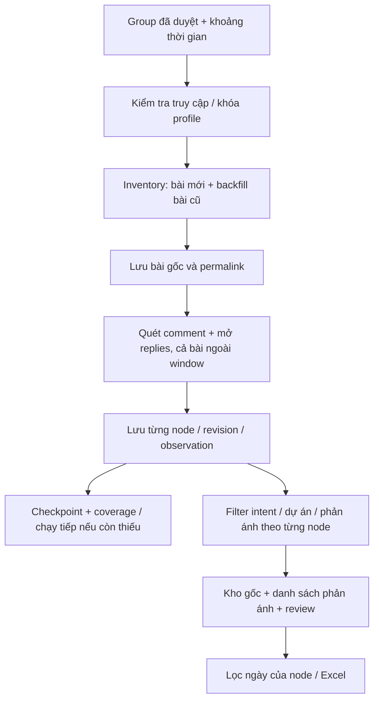

# Truy vết group: bài viết, bình luận và phản hồi theo thời gian

Ngày quyết định: **09/10/2026**. Đồng bộ **11/10/2026: core IMPLEMENTED / OFFLINE_VERIFIED, live coverage PARTIAL**. Raw store, thread inventory/rescan, tasks/leases/resume, node filtering, classification và dashboard đã có implementation; [runbook](../../docs/operations/dashboard-raw-v2.md), [backfill](../../docs/operations/unified-database-backfill.md), [trạng thái hiện hành](../../docs/current-state.md). Các GT requirements/acceptance bên dưới vẫn là target scope, chưa xác nhận thu mọi post/comment/reply. Schema: [conversation-record-v2](../contracts/conversation-record.md). Công việc: [TODO](../../TODO.MD).

## 1. Bài toán đã chốt

Trong các group đã duyệt, thu thập nội dung Facebook truy cập được, lưu bền vững rồi phân loại trong hệ thống. Khi chọn một khoảng ngày, tìm theo thời gian xuất bản của **từng nội dung**, gồm bài viết, comment và reply. Bình luận mới dưới bài cũ phải được xét, kể cả khi bài cha là quảng cáo hoặc tuyển dụng.

Ví dụ ngày 08/10/2026 theo giờ Việt Nam:

| Tình huống | Kết quả trong bộ lọc ngày 08/10 |
| --- | --- |
| Bài ngày 20/09, comment khiếu nại ngày 08/10 | Có comment; bài cha là ngữ cảnh ngoài khoảng ngày |
| Bài ngày 08/10, comment ngày 09/10 | Có bài; comment ngày 09/10 không thuộc kết quả ngày 08/10 |
| Bài bán vé ngày 01/10, comment không được hoàn tiền ngày 08/10 | Xét comment độc lập; không loại theo intent của bài cha |
| Comment cũ, reply khiếu nại ngày 08/10 | Có reply; giữ chuỗi cha để đọc ngữ cảnh |
| Thu thập ngày 09/10 nhưng chưa xác định ngày comment | Vào mục chưa xác định thời gian, không tính là phản ánh xác nhận ngày 08/10 |

**Thay đổi chính sách:** đối với chế độ truy vết group v2, rule tuyển dụng/bán hàng/thuê/mua bán/vay nợ/trao đổi chuyển sang lớp phân loại sau lưu trữ. Không DROP trước fetch vì có thể bỏ mất phản ánh trong comments. Không xóa kho gốc khi đổi nhãn hoặc rule. Các contract v1 và hành vi runtime cũ vẫn giữ nguyên cho đến khi triển khai migration/mode v2; không tuyên bố đã áp dụng thay đổi này trên dashboard hiện tại.

Phạm vi đầu tiên: group public đã xác minh và bật trong Registry; text bài/comment/reply, metadata và media references. Tải toàn bộ video, file ảnh, OCR và nội dung riêng tư không mặc nhiên nằm trong định nghĩa “crawl hết”. OCR là bước phân tích bổ sung theo [plan OCR](facebook-image-ocr.md), sau khi có kho gốc mới.

## 2. Requirements và traceability

| ID | Yêu cầu | Đối chiếu |
| --- | --- | --- |
| GT-001 | Thu bài/comment/reply của group đủ điều kiện; tách kiểm tra truy cập khỏi phân loại nội dung | FR-01/04; yêu cầu mới 09/10 |
| GT-002 | Lưu trước, phân loại từng node sau; parent DROP không làm child DROP; re-filter không cần crawl lại | FR-06, thay semantics retention v1 theo yêu cầu mới |
| GT-003 | Window theo thời gian của node; bài cha ngoài window chỉ là context; unknown time có nhãn rõ | FR-04/17 |
| GT-004 | Lập inventory bài cũ, quét lại comments/replies; không giới hạn parent bằng ngày bài đăng | FR-04/05; phạm vi comments mới |
| GT-005 | Identity post/comment/reply, quan hệ cha, revisions, observations; rerun không tạo nội dung trùng | FR-05/12 |
| GT-006 | Pagination, checkpoint/resume, timeout và coverage minh bạch; parser lỗi không phải thành công rỗng | FR-16 |
| GT-007 | UI kho gốc/phản ánh, bảng và thread detail; review/notes bền vững; export đúng bộ lọc | FR-17; yêu cầu UI mới |
| GT-008 | Migration có backup/rollback, tương thích dữ liệu cũ, bảo mật profile và cô lập lỗi nguồn | FR-05/16 |

## 3. Thu thập và xử lý bài cũ có comment mới

### Lượt đầu / lịch sử

1. Chốt window UTC từ ngày giờ Việt Nam, tạo run có snapshot cấu hình. Kiểm tra enabled/access và khóa profile Facebook hiện có; không dùng Google/SerpApi thay acceptance truy vết trực tiếp.
2. Xây inventory permalink của các bài truy cập được, gồm bài cũ. Không dừng inventory chỉ vì gặp bài có ngày trước window: dưới bài đó có thể có comment trong window. Nếu không thể duyệt hết lịch sử, ghi inventory PARTIAL hoặc UNKNOWN, lưu checkpoint để tiếp tục.
3. Với từng bài, lấy đủ text hiển thị, mở rộng text dài; chọn “tất cả bình luận” nếu UI hỗ trợ và ghi lựa chọn thực tế. Mở các lượt tải thêm bình luận, reply và nội dung bị thu gọn. Không coi “phù hợp nhất” là toàn bộ comments.
4. Không dừng dựa trên một comment cũ trừ khi đã kiểm chứng thứ tự thời gian của toàn bộ luồng. Pinned, ranking và reply có thể làm kết quả xen kẽ cũ/mới. Lưu các node đã đọc; chỉ hiển thị theo window ở lớp truy vấn.
5. Time budget/quota chỉ chia batch, không biến batch thành hoàn tất. Giữ dữ liệu đã lấy và trả trạng thái cần chạy tiếp, số bài chưa quét, comment/reply coverage.

### Lượt hằng ngày

- Thu bài mới và đưa vào inventory. Dùng tín hiệu “hoạt động gần đây” nếu UI có để ưu tiên, không dùng tín hiệu này làm bằng chứng đã tìm hết comment mới.
- Quét lại comments trên **các bài đã biết**, gồm bài cũ: nhóm hoạt động gần đây ưu tiên cao; nhóm ít hoạt động có lịch quét luân phiên theo tuổi lần quét cuối. Không đặt cutoff tuổi bài vĩnh viễn và không để nhóm ít hoạt động bị bỏ qua mãi.
- Lưu `last_comment_scan_at`, thời điểm scan hoàn tất quan sát được và checkpoint riêng mỗi bài. Watermark thời gian lớn nhất đã thấy chỉ là thông tin ưu tiên, không chứng minh đã quét hết.
- Dùng overlap/rescan và native ID để thu nội dung đến muộn/chỉnh sửa, không cộng trùng. Phân biệt ngày tạo, ngày sửa và ngày phát hiện. Mặc định filter là ngày tạo; “mới phát hiện” là lựa chọn khác.
- Bài cũ chưa có trong inventory vẫn là khoảng trống. Tiếp tục backfill đồng thời với incremental; UI phải hiển thị khoảng trống đó. Với yêu cầu lịch sử xa, cần hoàn thành nhiều batch thay vì hứa một lượt ngắn sẽ đủ.
- Lịch 05:00–08:30 và 17:00–18:30, chu kỳ 45 phút đã có chỉ là trigger. Job đang chạy không bị chồng; job mới tiếp tục checkpoint. Tách thời gian chạy lịch khỏi khoảng ngày dữ liệu cần lấy. Ngoài giờ chạy, dữ liệu đang thiếu vẫn được ghi là chưa hoàn tất.

### Định nghĩa coverage

Coverage có ba lớp: inventory bài của group; nội dung bài; comments/replies của từng bài. Trạng thái `NOT_STARTED`, `IN_PROGRESS`, `COMPLETE_OBSERVED`, `PARTIAL`, `BLOCKED`, `UNKNOWN`. `COMPLETE_OBSERVED` chỉ nghĩa là hết các phần UI truy cập được trong snapshot quan sát; không cam kết mọi nội dung từng tồn tại trên Facebook.

Ghi lý do dừng như TIME_BUDGET, QUOTA, LOGIN_REQUIRED, CAPTCHA, ACCESS_DENIED, PARSER_ERROR, PAGINATION_UNRESOLVED, DELETED_OR_UNAVAILABLE. Tổng comment hiển thị và tổng node đọc được lưu riêng; số tổng UI có thể gồm replies/nội dung ẩn nên không tự chuyển thành tỉ lệ chính xác. Mọi nguồn lỗi giữ dữ liệu đã lưu; nguồn khác tiếp tục.

Không thể cam kết “mọi phản ánh trong ngày chắc chắn có” trước khi chứng minh nguồn, inventory, comments và replies được quét. Không gắn nhãn 100% dựa vào hết 100 candidates, hết scroll giả định, hoặc Google không còn kết quả.

## 4. Thiết kế giao diện

### Tab Thu thập

Chọn dự án, một/nhiều group, khoảng ngày (mặc định hôm nay, giờ Việt Nam). Không bắt buộc keyword để crawl group; keyword/hashtag dùng cho phân tích hoặc search riêng. Chọn lần đầu/backfill hoặc tiếp tục; có nút **Bắt đầu**, **Chạy tiếp**, **Dừng sau batch**. Không reset kho khi tạo run.

Hiển thị từng group: bài đã lập inventory, bài đã quét comments, số post/comment/reply đã lưu, hàng chưa rõ thời gian, coverage, thời điểm scan và lý do dừng. Tách “đang chạy”, “còn thiếu” và “hoàn tất quan sát được”; không lấy số dòng là chứng nhận đầy đủ.

### Tab Dữ liệu gốc

Kho chung qua mọi run. Bộ lọc: dự án/group, khoảng ngày, loại POST/COMMENT/REPLY, từ khóa, trạng thái thời gian/extraction, nhãn phân loại. Mặc định ngày tạo **của từng dòng**, cho phép chuyển sang ngày thu thập; luôn ghi rõ cơ sở thời gian. Hàng chưa biết ngày nằm ở bộ lọc riêng, không biến thành ngày crawl.

| Cột | Ý nghĩa |
| --- | --- |
| UID | Native UID tác giả nếu đọc được, không phải ID nội dung |
| Tên | Tên tác giả/ẩn danh như UI hiển thị |
| Date | Ngày giờ của node theo Việt Nam, kèm độ chính xác |
| Nội dung / Comment | Text riêng của bài, comment hoặc reply |
| URL | Link trực tiếp khi có; nếu chỉ có bài cha thì ghi “Link bài cha” |
| Loại | Bài / Bình luận / Phản hồi |
| Group / Dự án | Nguồn và dự án, phân biệt dự án xác nhận với context từ group |
| Phân loại / Vấn đề | Nhãn hệ thống và lý do/evidence |
| Đánh giá / Ghi chú | Hai cột riêng, lưu bền vững |

Mở một dòng để xem thread: bài gốc, comment cha, replies, phần text làm bằng chứng, lịch sử thay đổi và coverage. Context ngoài ngày chọn có nhãn; không tăng số phản ánh trong ngày. Không giả định cùng người viết là cùng một nội dung.

### Tab Phản ánh

View phân loại trên kho gốc, không phải kho riêng. Mặc định hiển thị KEEP; REVIEW có mục chờ xác minh; tuyển dụng/bán hàng rõ intent nằm ở dữ liệu gốc và không xuất hiện như phản ánh. Parent bị loại không che comment khiếu nại. Phân loại mỗi node có thể đọc context cha nhưng phải trích evidence từ node/context và ghi rõ origin, không gán lời cha cho người comment.

Một thread có nhiều comment phản ánh: vẫn giữ từng dòng; số thread/vụ việc và số nội dung phản ánh là hai chỉ số khác nhau. Chưa triển khai gom vụ việc thì không gọi số comments là số vụ việc độc lập.

### Tab Nguồn & lịch

Quản lý group/dự án và lịch hiện có; chọn scope lịch, chế độ incremental/backfill, budget và backlog. Lịch không tự bật nguồn chưa duyệt. Hiển thị tuổi lần quét comments của bài cũ và backlog để người vận hành biết độ trễ.

### Excel

Xuất toàn bộ kết quả theo bộ lọc, không chỉ trang table đang xem. Một dòng/node; giữ UID, Tên, Date, Comment, URL cùng loại, group, parent/root IDs, project, precision, classification, review và notes. Text dài không được cắt âm thầm: tách sheet chi tiết có node ID; neutralize formula injection. Ghi window/time basis và coverage trong sheet metadata; không xuất credentials/cookies.

## 5. Storage và phân loại

Contract chi tiết: [conversation-record-v2](../contracts/conversation-record.md). Tách `content_nodes`, revisions, source occurrences, observations, run/checkpoints/coverage, analyses và reviews. Raw được lưu bất kể relevance; acquisition lỗi/missing data là trạng thái riêng với relevance.

Các rule cũ vẫn dùng làm nhãn, nhưng không gọi `store.reject`/purge trên raw v2. Excluded identity cũ không được ngăn thu lại bài cha trong mode này. Xóa raw chỉ qua tác vụ retention/admin riêng được yêu cầu, không do label DROP. OCR và LLM optional sau lưu; không tự chạy ASR/media download ở discovery.

Migration: backup DB; thêm schema version/tables; import record cũ thành POST, bảo toàn IDs/aliases/review/notes/observations; lớp đọc tương thích CLI/output post cũ. Các dữ liệu đã purge và comments chưa từng thu không thể phục hồi bằng migration: cần thu lại khi nguồn còn truy cập được. Có mapping và rollback, không sửa cấu trúc DB đang chạy bằng tài liệu này.

## 6. Acceptance trước ACP

Tất cả case dưới đây **PLANNED**, chưa pass. Offline fixtures trước, live có đối chứng sau.

| ID | Input / tình huống | Expected | Requirements |
| --- | --- | --- | --- |
| GT-AC01 | Post 20/09 + comment 08/10 | Comment có trong 08/10, parent chỉ là context | GT-003/004 |
| GT-AC02 | Post 08/10 + comment 09/10; reply 08/10 dưới comment cũ | Loại comment 09/10 khỏi window; giữ reply 08/10 | GT-003 |
| GT-AC03 | Bài bán vé/tuyển dụng + comment khiếu nại | Raw cả hai được lưu; chỉ comment có evidence vào phản ánh | GT-001/002 |
| GT-AC04 | Một UID viết 3 comments, rerun 2 lần | 3 nodes, nhiều observations, không gộp theo UID/text rỗng | GT-005 |
| GT-AC05 | Comments ranked/pinned, nhiều pages/replies | Mở phần tải thêm/replies; không dừng sớm theo ngày; coverage ghi đúng | GT-004/006 |
| GT-AC06 | Crash sau batch đã commit, retry và quota hết | Không mất/nhân bản dữ liệu; checkpoint resume; PARTIAL, không success rỗng | GT-005/006 |
| GT-AC07 | Null/relative/date-only time; biên 00:00 và end-exclusive | Precision/uncertainty đúng; không lấy collected_at giả published_at | GT-003 |
| GT-AC08 | Bài cũ ít hoạt động, comment mới; inventory chưa đầy | Bài đã biết được quét luân phiên; phần chưa biết được công khai là gap | GT-004/006 |
| GT-AC09 | Comment sửa/xóa/không còn truy cập | Revision/availability cập nhật; không thay ngày tạo bằng ngày sửa | GT-005 |
| GT-AC10 | Login hết hạn/CAPTCHA/selector thay đổi/khóa profile | Stop nguồn có typed error; cleanup context/lock; nguồn khác tiếp tục; không log secret | GT-001/006/008 |
| GT-AC11 | Đổi rule, override dự án, note; reload/rerun | Raw giữ nguyên; analysis version/history; review không mất | GT-002/005/007 |
| GT-AC12 | Filter table + export toàn bộ + link comment thiếu | Dòng/metadata khớp; parent fallback rõ; UID nullable; text dài xử lý đúng | GT-003/007 |
| GT-AC13 | Backup/migrate/rollback DB post cũ | Giữ dữ liệu/notes/IDs; CLI cũ tương thích; không invent comments đã mất | GT-008 |
| GT-AC14 | Pilot cùng group/window, đối chiếu bằng tay post/comment/reply kể cả bài cũ | Báo expected/observed/missed, lý do thiếu và coverage; reviewer ACP, không chỉ API trả 200 | GT-001–008 |

Pilot bắt đầu 1–2 group, có danh sách permalink đối chứng gồm bài cũ có comment mới; ghi ngày giờ, access mode, run/budget và kết quả. Chỉ mở rộng toàn watchlist sau kiểm chứng. Mục tiêu nghiệp vụ là không bỏ phản ánh trong tập đối chứng; ngoài tập quan sát phải ghi giới hạn, chưa đặt ngưỡng recall toàn Facebook.

## 7. Trình tự triển khai

1. GT-T01: contract/schema và bộ fixture đối chứng.
2. GT-T02: storage/migration và tách raw khỏi filter/purge.
3. GT-T03: parser comments/replies + identity/time/thread.
4. GT-T04: inventory/backfill + old-post sweep + checkpoints/coverage.
5. GT-T05: phân loại theo node/context, reprocess và lịch.
6. GT-T06: UI bảng/thread/run và Excel.
7. GT-T07: offline regression, pilot đối chứng, ACP.

Các bước 3–4 cần browser Facebook hiện có và quyền đọc comments thực tế. Không cần Facebook Graph API hoặc SerpApi cho pipeline truy vết này. Nếu UI không cho đọc đầy đủ, trả giới hạn coverage thay vì bypass hoặc ghi hoàn tất.
