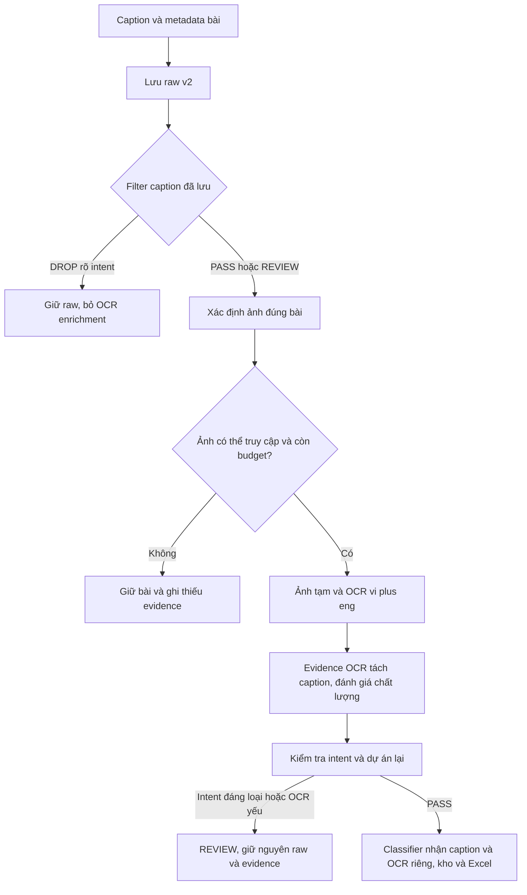

# Kế hoạch đọc chữ trong ảnh bài Facebook

**Cập nhật ưu tiên/chính sách 09/10/2026:** triển khai [kho raw và truy vết comments/replies](facebook-group-tracing.md) trước OCR. Trong mode group tracing v2, raw được lưu trước phân loại; các đoạn prefilter/purge của plan OCR này là baseline v1, không được dùng để xóa raw v2. OCR là evidence phân tích riêng, không tự thay caption hay ngày của node; GT-T02/T05 phải tách retention khỏi DROP trước khi nối OCR. Runtime raw v2/OCR đã triển khai ngày 10/10/2026; các chính sách purge v1 bên dưới là lịch sử, không áp dụng cho runtime v2.

Ngày kế hoạch: 09/10/2026. Cập nhật runtime 10/10/2026: **IMPLEMENTED / LIVE_PARTIAL / UAT_PENDING**. Tesseract vie+eng, Photo resolver, evidence/cache, classifier input, UI/filter và Excel đã triển khai; pilot thật OCR 3/5 ảnh. Gemini pilot trả HTTP 503 sau ba lần thử, chưa nghiệm thu phân loại live. Batch reprocess UI và benchmark 30–50 ảnh chưa hoàn thành. Xem [runbook](../../docs/operations/facebook-image-ocr.md). Phạm vi là ảnh đính kèm post; chưa OCR ảnh comments/replies, Page/profile hoặc khung hình video.

Mục tiêu: bổ sung bằng chứng mà caption không chứa, để nhận diện dự án và phát hiện quảng cáo/tuyển dụng hoặc phản ánh khách hàng. Giữ caption gốc, OCR text và nguồn ảnh tách riêng; không biến nội dung trong ảnh thành lời người đăng hoặc sự việc đã xác minh.

## 1 Kết quả cần có và phần đang thiếu

| Hiện trạng | Công việc cần làm | Kết quả |
| --- | --- | --- |
| Adapter lấy caption và một phần media_refs; chưa có resolver ảnh đầy đủ | Xác định đúng ảnh thuộc bài, mở ảnh khi cần lấy bản đủ chất lượng | Có danh sách ảnh gắn post ID, không lẫn avatar/comment/bài đề xuất |
| Chưa có Tesseract/Python OCR trong pipeline | Cài engine, dữ liệu vi/eng và wrapper | Chạy OCR local, không cần API key mới |
| Prefilter và project matcher dùng text bài | Thêm evidence OCR vào bước phân tích, giữ provenance | Lọc theo caption và chữ trong ảnh; không gán dự án từ query |
| Kho/Excel chưa có OCR evidence | Thêm trạng thái, text ảnh và bộ lọc cần review | Người dùng đọc lại, đối chiếu và đánh giá được |

Thứ tự làm: **ảnh đúng bài → OCR offline → evidence/storage → tích hợp filter → UI/Excel → pilot live**. Chưa có image resolver thì cài thư viện OCR cũng chưa giúp các bài Facebook có ảnh.

## 2 Workflow dự kiến

**OCR-001 — Chọn ảnh đúng bài, P0.** Chỉ lấy ảnh có liên kết với item đang xử lý. Không dùng screenshot toàn trang, avatar, ảnh bìa group, ảnh comments/replies, preview của bài đề xuất làm ảnh bài. Với album, thu theo thứ tự quan sát được và giới hạn cấu hình; vượt giới hạn phải ghi coverage PARTIAL. Thumbnail không đủ chất lượng thì thử ảnh lớn trong UI nếu nguồn/phiên cho phép; không tự báo thành công khi chỉ lấy được thumbnail hoặc ảnh không đọc được.

**OCR-002 — Resolver ảnh, P0.** Phân giải media_ref bằng phiên browser hiện có khi cần, không xuất cookie ra .env/log hoặc gọi URL tùy ý từ nội dung bài. Hạn chế URL/redirect tới host ảnh nền tảng đã cho phép. Kiểm tra loại file thật, kích thước byte/pixel và timeout; URL hết hạn thử lấy lại reference từ đúng bài trong cùng budget. Không giả lập đã lấy ảnh khi lỗi đăng nhập/CAPTCHA/access denied. Ảnh lỗi không làm mất caption và dữ liệu đã lấy của nguồn khác.

**OCR-003 — OCR local, P0.** V1 dùng Tesseract + pytesseract + Pillow, ngôn ngữ `vie+eng`, timeout hữu hạn. Phân biệt wrapper Python với binary engine và traineddata. Có lệnh kiểm tra engine/version/ngôn ngữ trước khi chạy; thiếu dependency báo UNAVAILABLE, không biến thành EMPTY. Module OCR/resolver thuộc src, orchestration thuộc engine.

Tiền xử lý cơ bản: áp dụng EXIF orientation, đổi màu phù hợp và kiểm soát kích thước; thử cấu hình segmentation trên tập ảnh mẫu trước khi chốt. Không crop mất nội dung để làm kết quả đẹp. Chưa thêm GPU, dịch vụ OCR cloud hoặc LLM vision trong v1; nếu baseline chưa đạt thì benchmark phương án khác ở task riêng.

**OCR-004 — Evidence và chất lượng, P0.** Lưu nguyên OCR text, phương pháp/version, ngôn ngữ, thời điểm UTC, ảnh tham chiếu và word boxes/confidence khi có. Điểm confidence Tesseract không phải xác suất bài liên quan dự án. Text rỗng, kết quả yếu, ảnh mờ và timeout là các trạng thái khác nhau. Không thay caption bằng OCR; không viết lại dấu/số tiền/ngày tháng như fact đã xác minh. Người review được thấy OCR text có thể sai.

**OCR-005 — Filter và project matching, P0.** Prefilter caption rõ DROP thì không tải ảnh/OCR. Với caption PASS/REVIEW, OCR ảnh theo budget ngay cả khi caption có text, vì ảnh có thể chứa intent/vấn đề khác. Khi phân tích lại, đưa OCR evidence vào project matcher và intent filter với provenance riêng, bảo vệ phản ánh về mua vé/hoàn tiền/không nhận được vé. Không loại chỉ vì một token OCR nhận diện thành “tuyển” hoặc “bán”. OCR thấp chất lượng/mixed intent chuyển REVIEW.

Pilot mặc định **không tự xóa bài chỉ dựa vào OCR** (`ocr_auto_drop=false`): đưa các trường hợp nghi tuyển dụng/bán vé từ ảnh vào danh sách cần review. Bật auto-drop từ OCR chỉ sau khi đối chứng chứng minh quy tắc đủ tốt và reviewer xác nhận. Khi đã xác nhận DROP, purge caption/raw/OCR/cache và ảnh liên quan của item, giữ rejection metadata như contract hiện có. Không suy diễn project/location từ query hay tên file ảnh; MATCHED phải có đoạn OCR evidence đủ đặc trưng. Bối cảnh group vẫn là CONTEXT_ONLY.

## 3 Dữ liệu và lưu trữ

**OCR-006 — Storage, dedup và retry, P0.** Dùng evidence OCR versioned liên kết record_id/media_ref, không nhét text OCR vào caption/raw_text hiện có. Trước triển khai chốt migration/schema và khả năng đọc record cũ. Item identity vẫn platform/native ID hoặc URL chuẩn; mỗi ảnh có hash file, mỗi kết quả OCR có engine/model/config version. Rerun không OCR lại ảnh không đổi khi còn cache hợp lệ; ảnh/config đổi tạo revision, không tạo bài trùng. Cache không chia sẻ nội dung thuộc item đã DROP.

| Trường dự kiến | Nội dung |
| --- | --- |
| `evidence_id`, `record_id`, `media_ref_id` | Liên kết evidence với đúng bài/ảnh |
| `type=ocr`, `schema_version` | Loại evidence và version |
| `text`, `language` | OCR text gốc, ngôn ngữ dùng khi chạy |
| `status` | AVAILABLE, EMPTY, UNAVAILABLE hoặc FAILED theo Unified Evidence |
| `quality_status` | ACCEPTABLE, NEEDS_REVIEW hoặc UNKNOWN; không coi AVAILABLE là chính xác |
| `error_code`, `missing_reasons` | IMAGE_UNRESOLVED, URL_EXPIRED, LOW_RESOLUTION, OCR_TIMEOUT, LANGUAGE_DATA_MISSING, BUDGET_EXHAUSTED... |
| `engine_version`, `traineddata_version`, `config_version` | Tái hiện kết quả và invalidation cache |
| `image_sha256`, `width`, `height`, `processed_at` | Hash file, thông số ảnh và UTC timestamp |
| `words` | Text, box x/y/w/h, confidence nullable; confidence -1 của Tesseract không dùng như điểm hợp lệ |
| `evidence_used` | Phân tích intent/project dùng đoạn nào; tách khỏi evidence có nhưng chưa dùng |

Ảnh raster dùng bounding boxes trong `words`, không dùng timestamp start/end của audio segments. Ảnh tải trong staging chỉ giữ tạm và dọn ở success/failure/cancel/startup recovery; v1 không giữ file ảnh lâu dài. Với bài được giữ, lưu OCR text/hash/provenance và reference; ảnh tham chiếu có thể hết hạn, không hứa người review luôn mở lại được. Nếu cần archive ảnh lâu dài phải chốt retention riêng.

Crash/retry: xử lý theo transaction/commit evidence hoàn chỉnh; không báo AVAILABLE trước khi OCR xong. Các ảnh đã xử lý thành công giữ kết quả khi ảnh sau lỗi. Purge item phải xóa evidence/cache liên quan và không cho rediscovery khôi phục nội dung đã bị chặn.

## 4 Cấu hình và nguồn lực pilot

Các mức dưới là baseline pilot; cấu hình runtime hiện tại và giới hạn đã triển khai được ghi trong [runbook](../../docs/operations/facebook-image-ocr.md).

| Hạng mục | Mặc định đề xuất |
| --- | --- |
| Bật OCR | Tắt cho đến khi offline fixtures đạt; bật riêng cho nguồn/dự án pilot |
| Provider | Tesseract local, `vie+eng` |
| Số ảnh | Tối đa 3 ảnh/bài, 50 ảnh/run |
| File ảnh | Tối đa 8 MB/ảnh và 20 megapixel trước decode/resize |
| Timeout | Download 15 giây/ảnh; OCR 20 giây/ảnh; chia sẻ deadline source/run |
| Đồng thời | 1 worker OCR lúc đầu; giới hạn CPU/memory theo máy test |
| Retry | Tối đa 1 retry URL tạm thời trong budget; không lặp vô hạn |
| Auto-drop từ OCR | Tắt trong pilot, cần review/đối chứng trước khi bật |
| Dữ liệu cũ | Reprocess theo dự án/batch có giới hạn; không tự OCR toàn kho khi khởi động |

Nếu source còn ít thời gian thì hoãn OCR sang lượt/batch enrichment riêng và ghi DEFERRED/BUDGET_EXHAUSTED; không tự kéo dài lịch 45 phút hoặc tạo job chồng. Caption, window và published_at giữ như acquisition, OCR không biến thời điểm xử lý thành ngày đăng. Không cần API key cho OCR local.

Cần có: binary Tesseract cho Windows; traineddata `vie` và `eng`; Python packages pytesseract/Pillow trong venv dự án; thư mục staging writable; phiên Facebook khi ảnh yêu cầu; tập ảnh mẫu có nhãn đối chứng. Dùng biến cấu hình đường dẫn như TESSERACT_CMD/TESSDATA_PREFIX khi engine không nằm trong PATH, không ghi đường dẫn một máy vào core code.

Nguồn kỹ thuật đã chọn: [pytesseract](https://pypi.org/project/pytesseract/), [Tesseract installation](https://tesseract-ocr.github.io/tessdoc/Installation.html), [language data](https://tesseract-ocr.github.io/tessdoc/Data-Files-in-different-versions.html).

## 5 Giao diện và Excel

**OCR-007 — Review output, P1.** Trong cột Nội dung, tách “Caption” và “Chữ trong ảnh”; mỗi ảnh có trạng thái/quality và tham chiếu. Bổ sung bộ lọc chưa OCR/OCR lỗi/cần review, nút OCR lại cho một bài hoặc batch được chọn có quota. Giữ Đánh giá/Ghi chú và project selector hiện có.

Excel thêm OCR text, OCR status/quality và số ảnh xử lý/tổng ảnh quan sát được; không nhân số dòng bài vì một bài có nhiều ảnh. Có sheet evidence chi tiết nếu cần word/ảnh mapping; không tự chèn mọi ảnh vào workbook. Export tránh formula injection và text vượt giới hạn ô Excel: chia evidence ở sheet phụ, ghi rõ phần chia, không cắt im lặng. File export và kho dùng cùng bộ lọc dự án.

## 6 Công việc và điều kiện nghiệm thu

| Task | Ưu tiên / trạng thái | Công việc | Kết quả để ACP |
| --- | --- | --- | --- |
| OCR-T01 | P0 / PLANNED | Chuẩn bị môi trường, fixture ảnh tiếng Việt và bản text đối chứng | Engine/ngôn ngữ chạy được; manifest dependencies; tập mẫu và quyền dùng rõ |
| OCR-T02 | P0 / PLANNED | Media resolver ảnh đúng post/album, giới hạn tải | Không lấy avatar/comment/recommendation; expired URL/errors có outcome |
| OCR-T03 | P0 / PLANNED | Module OCR, preprocess, timeout và quality | OCR offline đối chiếu; AVAILABLE/EMPTY/FAILED/UNAVAILABLE phân biệt |
| OCR-T04 | P0 / PLANNED | Contract/migration/evidence/cache/cleanup | Record cũ đọc được; caption không đổi; retry/dedup/purge đúng |
| OCR-T05 | P0 / PLANNED | Nối OCR với intent/project filter và enrichment budget | Không OCR caption DROP; protected complaint giữ; low quality REVIEW; deadline bounded |
| OCR-T06 | P1 / PLANNED | UI/reprocess từng bài/batch/Excel | Text/trạng thái đọc được; export đủ mapping, review notes không mất |
| OCR-T07 | P0 / PLANNED | Pilot trên group VinWonders Vũ Yên có đối chứng | Báo cáo chất lượng, false drop, vấn đề phát hiện thêm, thời gian và coverage; reviewer xác nhận |

Dependency: T01 → T03; T02 và T04 có thể chuẩn bị song song với T03; T02/T03/T04 → T05 → T06 → T07. Chưa tự gán ngày hoàn thành; thời lượng phụ thuộc số ảnh mẫu, chất lượng ảnh và nguồn truy cập được. Đây là kế hoạch OCR, không bao gồm triển khai comments/replies.

## 7 Acceptance và đo chất lượng

| ID | Input / tình huống | Expected / requirement |
| --- | --- | --- |
| OCR-AC01 | Ảnh rõ có tiếng Việt và số tiền | OCR text có provenance; đối chiếu đúng key phrase/số tiền, không sửa thành fact — OCR-003/004 |
| OCR-AC02 | Caption rỗng, ảnh “bán vé...” | OCR được chạy; pilot đánh dấu cần review intent; không tự xóa khi auto-drop tắt — OCR-005 |
| OCR-AC03 | Caption tuyển dụng rõ DROP | Không gọi resolver/download/OCR; không lưu ảnh/OCR — OCR-001/005 |
| OCR-AC04 | “Mua vé nhưng không nhận được mã QR”, “không hoàn tiền” trong ảnh | Giữ phản ánh để review; không loại chỉ vì vé/mua — OCR-005 |
| OCR-AC05 | Ảnh mờ, OCR nhận nhầm “tuyển” | NEEDS_REVIEW; không hard-drop từ token sai — OCR-004/005 |
| OCR-AC06 | Ảnh không có chữ | EMPTY, không FAILED; caption vẫn giữ — OCR-003/004 |
| OCR-AC07 | Avatar/comment/ảnh bài đề xuất có text | Không được đưa vào OCR evidence bài gốc — OCR-001 |
| OCR-AC08 | Album 5 ảnh, quota 3 | Xử lý tối đa 3, ghi PARTIAL/giới hạn, không báo đã đọc cả album — OCR-001/002 |
| OCR-AC09 | URL hết hạn, engine thiếu vie, timeout | Outcome riêng; giữ phần evidence thành công, không mất bài/nguồn khác — OCR-002/003/006 |
| OCR-AC10 | Ảnh/file/config không đổi rồi rerun | Dùng cache đúng version; không thêm bản ghi bài trùng — OCR-006 |
| OCR-AC11 | DROP sau review/model trong raw v2 | Giữ raw/OCR và review notes; DROP chỉ là nhãn phân tích, không purge dữ liệu — OCR-005/006 |
| OCR-AC12 | OCR có tên dự án, chỉ group/query có tên dự án | Tên OCR đủ evidence có thể MATCHED; query không chứng minh, group CONTEXT_ONLY — OCR-004/005 |
| OCR-AC13 | Crash, hết run budget, còn ảnh chưa xử lý | Không có success giả; evidence đã commit giữ được; retry bounded, staging dọn — OCR-002/006 |
| OCR-AC14 | Export một bài nhiều ảnh, text dài/đầu dấu bằng | Một dòng bài, evidence liên kết đúng, không formula injection/cắt im lặng — OCR-007 |

Tập đối chứng đề xuất 30–50 ảnh, gồm chữ rõ, nhỏ/mờ, quảng cáo vé/tuyển dụng, phản ánh và ảnh không chữ. Pilot 1–2 group trước, sau đó mở rộng 7 group nếu đạt. Đo độ đúng key phrases/project names, lỗi số/ngày/giá tiền, tỷ lệ ảnh lấy được/OCR được/cần review, thời gian median/p95 và phản ánh phát hiện thêm so với caption-only. Không lấy điểm confidence engine thay đánh giá đối chứng.

Gate bắt buộc: fixture DROP không tải/OCR; fixture protected complaints không bị loại; không gán project/location thiếu evidence; không làm mất caption/notes hoặc tạo duplicate; cleanup/privacy retention đúng. Ngưỡng chất lượng tối thiểu cần chốt từ baseline và reviewer, chưa tuyên bố đạt độ chính xác hoặc coverage trước pilot. Chỉ bật auto-drop OCR sau gate riêng này.

Traceability: OCR-001/002/003/004/006 → FR-07/11; OCR-005 → FR-02/06/11; OCR-006 → FR-05/12; OCR-007 → FR-13/14. Contracts liên quan: [Unified Evidence](../contracts/unified-evidence.md), [Exclusion Rules](../contracts/exclusion-rules.md), [Source Adapter](../contracts/source-adapter.md), [Project filter](project-customer-feedback-filter.md), [TODO](../../TODO.MD).
